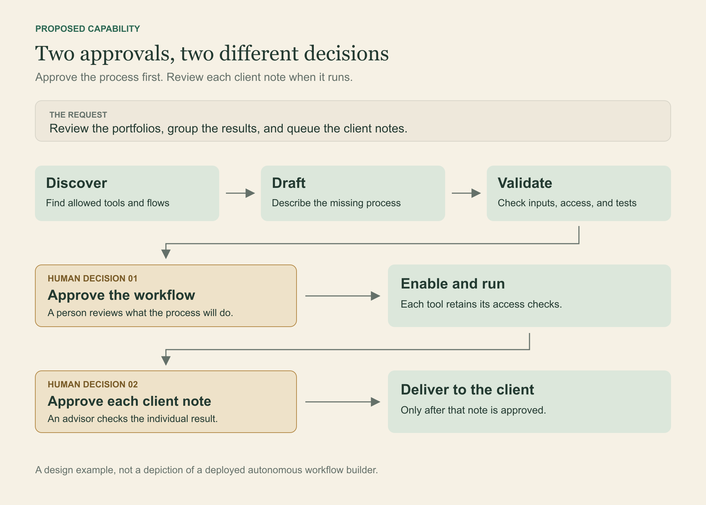

An advisor types: "Show me which portfolios need attention. Group them by the reason for review, and let me approve each client note."

One sentence. Several jobs.

The software needs to identify the advisor, find the accounts they may access, check their holdings against the right targets, and collect the results. The notes need a review queue.

Now suppose the application can do all those things, but no existing workflow joins them in quite that order. Could an agent join the pieces?

That is a capability I want to develop in OakQuant, the financial research and planning platform I built. Acorn is its agent component. The workflow-building sequence in this article is a proposed capability, and the advisor's request is an example of what it would need to handle.

The possibility interests me because an agent could start with software the user already has and find a useful process among capabilities that are already available. First, it needs a catalog.

## Give the agent a menu it can read

A waiter who knows the menu can answer a useful question: "What can I eat if I cannot have dairy?"

The waiter needs the ingredients. They also need to know what the kitchen has run out of before recommending a dish the customer can order. Eloquence will not replenish the cheese.

An agent needs that same detail about its tools: the functions it can ask the software to run when it needs a profile or wants to start a known process.

Each description should tell the agent what a tool does and what information it needs to supply before the tool can return a useful result. The description also needs to distinguish reading a record from changing it.

OakQuant registers tools and defines workflows and screens as structured data. These catalogs, called registries, describe the platform's capabilities in a form that can be read without searching through every source file to discover what each part does.

Acorn already has registered tools. Letting it read more of those catalogs would help it find which parts of the existing software can finish the job the person has asked it to do.

That is the idea I find most powerful here. The software is readable to the thing that is supposed to help run it.

## Read what the pieces produce

Return to the advisor's request. A saved workflow called "portfolio review" sounds promising. Open its definition and the steps tell you what it actually delivers: perhaps a report, perhaps an assignment waiting for a decision.

The difference matters to the next step. A report written for a person and a set of review records that software can group are different inputs, even when they describe the same portfolios.

An agent building a process needs to follow those inputs and outputs. What does the drift check return? Does each result identify its account and the reason for review? Can the next tool read those fields?

Names help, and the ladder from the first article still applies: look for an existing workflow by name, then by meaning, and only then ask a model to draft a new one. The descriptions let the agent examine how one piece of software could supply what another piece needs, including the fields that must survive each handoff.

The advisor asked for grouped reviews. Most of the work may already exist. Reading the catalog could reveal exactly where the connection is missing.

## Make the missing step visible

Suppose the catalog contains a drift check, a note-drafting step, and an advisor assignment. It has no saved workflow that groups those reviews in the way the advisor asked.

An agent could map the request to those steps and mark the gap. For this example, assume the catalog also provides access to the advisor's portfolios. Here is the proposal:

1. Available step: retrieve the portfolios this advisor is permitted to review.
2. Available step: run the drift check for each eligible portfolio.
3. Missing connection: group the results by the reason for review. A compatible grouping tool still needs to be found or built.
4. Available step: prepare a note using the recorded figures.
5. Available step: create an assignment for each review, with client delivery awaiting approval.

The third step gives the proposal a useful test. The agent has to find a real grouping capability and show how the review data will pass through it. If that capability is missing, the proposal gives a developer a precise addition to build.

Now there is a smaller development task. A developer can inspect the missing grouping step and the records it would receive instead of having to reconstruct the whole request from the advisor's opening sentence.

Once that step exists, the proposed sequence can be tested with synthetic accounts. A person would approve the workflow before it was enabled. The advisor would still approve each client note during its use.

## Before the proposal becomes a process

An advisor asking for "all portfolios" means the accounts within their access. Acorn's authenticated tool path supplies the signed-in user's identity from the server for user-scoped tools. The surrounding application uses that identity to enforce access.

The proposed workflow would have to preserve that scope through each tool call. It would also need checks for an account with no target, a retry that could create a duplicate assignment, and a missing approval step.

Those tests belong beside the proposal so a reviewer can examine the sequence and what happened when it ran on the test accounts. Enabling a workflow and approving the client notes it later produces remain separate decisions.

Count repairs too. A proposal that takes seconds to generate can still create hours of work if mistakes are scattered across a queue of client reviews.

## One addition could serve the next request

Suppose the grouping step passes its tests. Add its description to the catalog, alongside the other capabilities, and a later request has one more piece of software available to work with. The catalog has grown.

The next advisor asks for a different grouping. The tool may already support it. If so, the agent could propose another arrangement with more of the work available before a developer needs to add anything.

I want to explore how a person's request could reveal a gap in the software, and how filling that gap could expand what later requests can accomplish.

The catalog would change as the platform grows. A new tool would arrive with a description of what it accepts and returns, making its contribution available to the next agent trying to assemble a process.

The advisor's sentence at the start would be a demanding test. I would want to see a proposal that identifies the available steps, names the missing connection, and leaves a developer with a concrete piece of work.

That would make the conversation useful before the new workflow even ran. The person asking for help and the person extending the software would have something specific to discuss.

Choose one request your users make this week. List the tools it needs, including what each accepts, returns, and is allowed to change. Give that list to a colleague and ask them to assemble the process. Mark where they have to guess. That is where the catalog needs work.

This is the third of four articles about building OakQuant. The next follows a forecast from its first estimate to the record of what happened.

Explore the existing workflows at [sky.oakquant.ai](https://sky.oakquant.ai/) and follow the development of these ideas on [OakQuant Press](https://press.oakquant.ai/public/articles).
