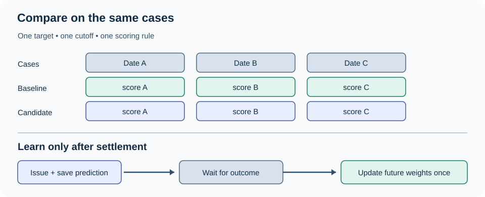

An analyst tests a new five-session stock forecast. It calls six of ten directions correctly. Then she checks the same ten dates against a rule that always predicts a gain: seven correct. The sophisticated model has lost its first contest. Worse, ten calls are too few to establish whether either result will hold up.

A model has to improve on a simple forecast **on the same future cases**. It also has to show that updates from settled results improve later forecasts. Baselines test the first claim; regularization and carefully timed gradient updates test the second.

*A fair comparison fixes the cases before scoring; an online learner changes only after the corresponding outcome becomes available.*

**In brief:** Start with a target-matched baseline. Fit a modest model on past data, then test whether delayed, bounded updates beat periodic refits. The tradeoff is responsiveness versus noise.

**Contents:** [Why use it?](#why-use-it) · [How it works](#how-it-works) · [The math](#the-math) · [Where OakQuant uses it](#where-oakquant-uses-it) · [Where it is used elsewhere](#where-it-is-used-elsewhere) · [Alternatives and tradeoffs](#alternatives-and-tradeoffs) · [People, libraries, and further reading](#people-libraries-and-further-reading)

## Why use it?

A baseline prevents a model from claiming credit for an easy market. If most stocks rise during a test period, a high direction hit rate may say little about the model's signals. A no-change price, an empirical return distribution, or a sector reference can set a more demanding standard. Forecasting competitions have long made simple methods part of the comparison; the [M4 competition's published study](https://doi.org/10.1016/j.ijforecast.2019.04.014) reports its benchmark methods and evaluation design.

The baseline must answer the *same question* as the candidate. A no-change **price** is a point forecast; it cannot be scored against a candidate's **gain probability** using probability loss. For that test, estimate a probability from prior, comparable outcomes, or form a full baseline return distribution. A five-session total-return target also needs the same dividend convention and issue cutoff on both sides.

When the simple method performs as well as the candidate, use it. It needs fewer inputs, is easier to audit, and has fewer ways to fail when an input is missing. More elaborate learning earns its place only through out-of-time improvement in the chosen score, with coverage measured alongside accuracy.

## How it works

First, define the forecast contract: instrument, issue time, five *trading* sessions, adjusted-price or total-return convention, and the event to be scored. Keep an as-issued record of the input features, model version, prediction, and baseline. A later price revision must not silently change the question the model answered.

Next, fit each candidate using information available before its training cutoff. A baseline might use the distribution of prior five-session returns. A linear model can use standardized features such as recent return and market-relative return. **Ridge regression** reduces unstable coefficients when those features overlap: it pays a penalty for large weights while fitting the observed returns. That penalty is chosen on earlier validation dates, not on the final test period. [Scikit-learn's ridge documentation](https://scikit-learn.org/stable/modules/generated/sklearn.linear_model.Ridge.html) gives the objective and implementation details.

Suppose an earlier window has 50 comparable five-session outcomes, 30 of them gains. Its empirical gain rate is 0.60. That is an *observed frequency in a chosen sample*, not proof that the next stock has a 60% gain probability. The window, cohort, and treatment of overlapping returns are modeling choices. Freeze them before scoring the next period.

A logistic model trained on earlier cases also issues 0.60 for a new gain event. The outcome later settles as a loss. The model may update its coefficients from that miss, but the original 0.60 remains the forecast to score. A delayed label can arrive after other forecasts have been issued, so the learner must identify the issued example, confirm when the label became available, and apply it once in a declared order. Several stocks may also fall together on one date: treating those correlated misses as independent evidence can push the model too far.

Finally, compare baseline and candidate on their **shared eligible cases** using a score suited to the output, such as Brier loss for binary probabilities. Also evaluate the whole service policy, including its fallback, over every case it intends to cover. Those two evaluations answer different questions: whether the model adds skill when present, and whether the complete system serves its stated coverage.

## The math

For a one-feature return model with no intercept, ridge minimizes squared error plus a penalty:

$$
\hat\beta=\underset{\beta}{\arg\min}\left[\sum_i(y_i-\beta x_i)^2+\lambda\beta^2\right]
=\frac{\sum_i x_i y_i}{\sum_i x_i^2+\lambda}.
$$

Here $x_i$ is a known feature, $y_i$ is the later observed return expressed as a decimal, $\beta$ is its fitted coefficient, and $\lambda\geq0$ sets the shrinkage. If $\sum x_i y_i=0.08$, $\sum x_i^2=4$, and $\lambda=1$, then $\hat\beta=0.016$. For a new $x=0.5$, the predicted return is $0.008$, or **0.8%**. Without the penalty, it would be $0.01$, or **1%**. This arithmetic illustrates shrinkage; it is not a measured market result.

For a binary gain event, logistic regression converts a feature score into a probability $p=1/(1+e^{-w^\top x})$. On a single issued example, the log-loss gradient for coefficient $w_j$ is

$$
g_j=(p-y)x_j,\qquad w_j^{\mathrm{new}}=w_j-\eta g_j.
$$

$y$ is 1 for a gain and 0 for a loss, $x_j$ is the issued value of feature $j$, and $\eta$ is the step size. If $p=0.60$, $y=0$, $x_j=1$, and $\eta=0.10$, ordinary stochastic gradient descent subtracts **0.06** from that coefficient. This is a one-example illustration. Production updates may include sample weights and regularization, and an online algorithm may not use this plain update rule.

**AdaGrad** replaces one shared step size with a history-dependent step for each coefficient. In a common diagonal form, $G_{j,t}=\sum_{s=1}^{t}g_{j,s}^{2}$ and $w_{j,t+1}=w_{j,t}-\eta g_{j,t}/(\sqrt{G_{j,t}}+\epsilon)$, where $t$ indexes eligible updates and $\epsilon>0$ avoids division by zero. Rarely active features can retain relatively large steps; a long run of gradients can make later steps very small. [Duchi, Hazan, and Singer's paper](https://jmlr.org/papers/v12/duchi11a.html) develops the method and its guarantees. **FTRL-Proximal** is a different adaptive online optimizer: it combines accumulated gradients with proximal regularization and can leave many feature weights exactly zero. It should not be described as plain gradient descent with a variable learning rate.

## Where OakQuant uses it

The relevant shared ML code lives in **Timber** (`timber/common/learning/`). Its `EmpiricalBaseline` produces an empirical return distribution, including a positive-return frequency and interval, explicitly marked uncalibrated. `ReturnRidge` fits regularized return coefficients. Timber's `fit_panel` can build zero-mean and empirical baselines, ridge, and a `sparse_logistic` candidate from eligible, cutoff-bounded panel rows; fitted candidates are marked **shadow requires evaluation**. These are implemented primitives and a fitting path, not evidence of profitable live forecasting.

Timber also implements `SparseLogistic`, an FTRL-Proximal learner. It issues a receipt containing the as-issued features and probability, then accepts a matured binary label in availability order. It rejects duplicate or conflicting updates and requires date-normalized example weights. Its own module explicitly says it does **not** establish point-in-time feature provenance or calibration; those obligations sit with the caller and evaluation pipeline. There is no AdaGrad implementation in this local path.

**Cambium** has a separate outcome-feedback and model-comparison layer (`cambium/cambium/adapt/`). It records predictions and outcomes, scores mature results, and provides performance reweighting and matched candidate comparisons. Its exponentially weighted strategy updates are not the same algorithm as Timber's FTRL coefficient updates. Whether any combination should be promoted into a user-facing forecast remains an evaluation decision. Shared market learning must use appropriately authorized market data; private household records do not train a shared market model.

## Where it is used elsewhere

Google's [published account of its deployed ad click-through prediction system](https://research.google/pubs/ad-click-prediction-a-view-from-the-trenches/) describes online logistic learning with FTRL-Proximal and a large, sparse feature space. The paper documents that system's setting and engineering choices. It does **not** show that the same optimizer will improve stock-return forecasts: ad clicks provide a different label, cadence, and economic environment. Its transferable lesson is how to handle numerous sparse signals and delayed feedback without confusing an issued prediction with a later model state.

## Alternatives and tradeoffs

| Approach | Useful when | What it gives up or risks |
|---|---|---|
| Empirical or no-change baseline | Evidence is sparse, or added features have not beaten a simple reference | Misses genuine conditional effects; a point baseline alone cannot support probability scoring |
| Batch ridge with scheduled refits | Numeric signals overlap and labels arrive in batches | Stable and auditable, but refits can lag drift; shrinkage can suppress real effects |
| Plain online logistic gradient | Binary outcomes arrive regularly and a small model needs frequent updates | Simple update, but one step size can overreact to correlated losses or undershoot change |
| AdaGrad | Feature frequencies vary sharply | Per-feature steps help rare signals, but accumulated squared gradients can slow later adaptation |
| FTRL-Proximal | Many sparse event indicators need online learning and zero coefficients | More state and tuning; sparse weights and fast updates do not establish calibration or out-of-time skill |

The decision is empirical: declare the baseline, score, cutoff, update cadence, and failure behavior first; then compare on held-out chronological cases. An optimizer's speed or sophistication is not itself a forecast result.

## People, libraries, and further reading

Arthur Hoerl and Robert Kennard introduced ridge regression for correlated predictors in their [1970 *Technometrics* paper](https://doi.org/10.1080/00401706.1970.10488634). John Duchi, Elad Hazan, and Yoram Singer developed the influential [AdaGrad treatment](https://jmlr.org/papers/v12/duchi11a.html). H. Brendan McMahan and colleagues documented [FTRL-Proximal in Google's click prediction work](https://research.google/pubs/ad-click-prediction-a-view-from-the-trenches/). These are contributions to distinct parts of the method, not a single invention called “adaptive gradients.”

For a practical first stop, use the official [scikit-learn `Ridge` guide](https://scikit-learn.org/stable/modules/generated/sklearn.linear_model.Ridge.html) and [`SGDClassifier` guide](https://scikit-learn.org/stable/modules/generated/sklearn.linear_model.SGDClassifier.html), including its `partial_fit` behavior. For the sparse online variant, TensorFlow publishes an [official FTRL optimizer reference](https://www.tensorflow.org/api_docs/python/tf/keras/optimizers/Ftrl). These are public learning tools, not a list of OakQuant dependencies. For the deeper argument about adaptive steps, read [Duchi, Hazan, and Singer](https://jmlr.org/papers/v12/duchi11a.html); for a documented application, read [McMahan and colleagues](https://research.google/pubs/ad-click-prediction-a-view-from-the-trenches/).
