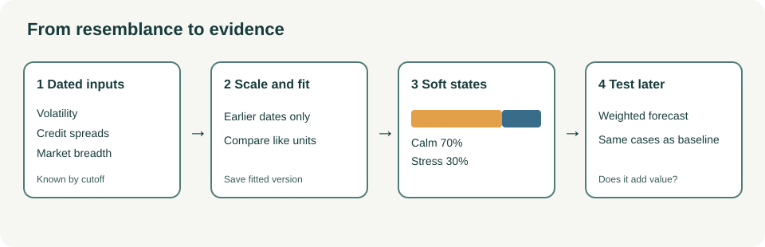

A stock's trading volume jumps while credit spreads widen and fewer stocks rise. On another date, the same jump follows an earnings report. A forecast that treats these two events alike may miss the conditions that give the volume its meaning.

Clustering finds observations that resemble one another before deciding whether that resemblance helps predict anything. It can suggest market states, company peers, or forecasters with a shared blind spot. The group itself is a description, never a forecast.

*A useful cluster earns its place by improving a later decision, not by acquiring a persuasive name.*

**In brief:** Group observations using facts known at the decision time, preserve uncertain assignments, and test their value on later forecasts. Extra flexibility can also produce attractive patterns that vanish out of sample.

**Contents:** [Why use it?](#why-use-it) · [How it works](#how-it-works) · [The math](#the-math) · [Where OakQuant uses it](#where-oakquant-uses-it) · [Where it is used elsewhere](#where-it-is-used-elsewhere) · [Alternatives and tradeoffs](#alternatives-and-tradeoffs) · [People, libraries, and further reading](#people-libraries-and-further-reading)

## Why use it?

An industry code is a useful first guess at a company's peers. It may miss that two firms depend on the same fuel price or funding market. One market-wide model may miss that its errors gather during credit stress. Clustering can reveal candidate relationships without requiring someone to label every historical day.

There are three distinct jobs. **Peer discovery** groups firms by a defined exposure or by returns after removing broad market movement. **State discovery** groups dates by volatility, credit spreads, breadth, or other information known at the time. **Error grouping** finds forecasters that fail on the same settled opportunities; near-duplicates should not count as independent votes. Each job needs its own features and test. [Von Luxburg, Williamson, and Guyon](https://proceedings.mlr.press/v27/luxburg12a.html) argue that cluster quality must be judged by the intended use.

If a formal sector, a volatility threshold, or the original features in a simple model work just as well on later dates, the grouping has not earned its cost.

## How it works

Take a fictional lender's stock on a day when credit spreads widen. A team asks whether that day's five-session gain forecast should change because it resembles past stressed markets. First it fixes the **cutoff**: the instant at which the forecast would be issued. It builds one feature vector for each historical date from facts available by its cutoff. It fits feature scaling on earlier dates only; otherwise the feature with the largest units can dominate the distance.

Next it fits a grouping on the training window. **K-means** assigns the current date to its nearest fitted centre. A **Gaussian mixture** gives a share for each fitted component. Those shares are estimates under a model, not proof that markets contain literal hidden labels. The [scikit-learn clustering guide](https://scikit-learn.org/stable/modules/clustering.html) describes distance-based methods; its [mixture guide](https://scikit-learn.org/stable/modules/mixture.html) describes probabilistic component assignments.

Market observations also arrive in sequence. A **hidden Markov model** adds transition probabilities, estimating how often a state persists or changes. **Filtering** estimates the state from evidence available so far. **Smoothing** also uses later observations; it can describe history but cannot supply an as-issued state for a backtest. The [St. Louis Fed explains](https://www.stlouisfed.org/on-the-economy/2025/may/making-sense-recession-probabilities) why its published smoothed recession series can revise earlier months using subsequent data.

Finally, the team tests the proposed grouping. Fit the conditional forecast on earlier dates, issue predictions on later dates, and compare on the *same* opportunities with a model that sees the original inputs but no cluster label. Refit on nearby windows and seeds. A [silhouette score](https://scikit-learn.org/stable/modules/clustering.html#silhouette-coefficient) can reveal poor geometric separation, but an elegant silhouette does not establish forecasting value. Keep groups large enough to support comparison; allow unfamiliar observations to remain unclassified; save each fitted version with the forecasts it informed. For overlapping five-session outcomes, evaluate in date blocks instead of counting adjacent days as independent trials.

Peer and error grouping follow the same sequence with different inputs. For peers, estimate market exposure on earlier shared dates, then compare residual returns and any business exposure relevant to the question. For errors, align predictions by subject, issue cutoff, and horizon. Compare return errors with return errors or probability errors with probability errors. A correlation based on a few common dates is weak evidence of a shared failure mode.

## The math

K-means chooses centres to minimize squared distance within groups:

$$
\min_{c_1,\ldots,c_K}\;\sum_{i=1}^{n}\min_{1\leq k\leq K}\lVert x_i-c_k\rVert_2^2.
$$

Here $x_i$ is observation $i$'s scaled feature vector, $c_k$ is group $k$'s centre, $K$ is the number of groups, and $n$ is the number of training observations. The objective favors compact groups in the chosen geometry. It says nothing about future returns.

For a soft assignment, let $w_k=P(Z=k\mid x_{\leq t})$ be the estimated share for state $k$ using inputs through cutoff $t$. Let $p_k=P(Y=1\mid Z=k,x_{\leq t})$ be the estimated chance of the target event in that state. Then

$$
P(Y=1\mid x_{\leq t})=\sum_{k=1}^{K}w_kp_k,\qquad \sum_{k=1}^{K}w_k=1.
$$

$Z$ is a modeled latent state; $Y=1$ means the stated event occurs. This is the law of total probability when the state shares and conditional forecasts are coherent estimates. In a **synthetic** example, calm and stressed shares are $0.70$ and $0.30$, with five-session gain chances of $0.55$ and $0.40$. The combined chance is $0.70(0.55)+0.30(0.40)=0.505$, or **50.5%**. A forced calm label would yield 55% and discard state uncertainty. Neither number proves predictive skill before later outcomes are scored.

## Where OakQuant uses it

An existing online **news-topic clusterer** in `oak-domain-investments/oak_domain_investments/adapt/cluster.py` embeds article text, assigns it to a nearby centroid or opens a new cluster, and emits topic-level sentiment features. This is distinct from grouping stocks or market dates. The local [FABLE 52 ML plan](../FABLE_52_ML_PLAN.md) documents limitations in the news features, including changing cluster identifiers and duplicate articles; having a clusterer does not establish forecast improvement.

In **Cambium**, `cambium/cambium/adapt/competition_scenarios.py` accepts caller-declared sector and regime labels with a known-at timestamp and produces replayable, shadow-only loss reviews. It does not learn labels or change serving. The local model-competition plan puts residual-error clustering and as-of qualification in a later phase. The [FABLE 52 ML plan](../FABLE_52_ML_PLAN.md) proposes market regimes and learned peers as future work. The inspected code and plans show no learned stock, sector, or market-state clustering in the live forecast route. Cambium's separate conversation-intent `regime.py` describes an interaction state, not a market state.

For the proposed design, investment-domain market features and estimators belong with the investment model; generic matched-loss and blend arithmetic belongs in Cambium; changeable workflow wiring belongs in Grove configuration. Shared market-model training must use approved market evidence, not private household records.

## Where it is used elsewhere

The [Federal Reserve Bank of St. Louis publishes a Smoothed U.S. Recession Probabilities series](https://fred.stlouisfed.org/series/RECPROUSM156N) from work by Marcelle Chauvet and Jeremy Piger. Its notes describe a dynamic-factor Markov-switching model using four monthly economic indicators. That is a documented use of probabilistic economic-state modeling, not evidence that a state label forecasts a particular stock. Because the published series is smoothed using later revised data, a historical graph of it cannot be inserted unchanged into a real-time backtest.

## Alternatives and tradeoffs

| Approach | When it helps | What it gives up or risks |
|---|---|---|
| Fixed sector or volatility rule | A clear, cheap baseline with little history | Misses cross-sector exposure or gradual changes; thresholds can be brittle. |
| K-means | Quick exploration of compact numerical groups | Hard assignment, chosen $K$, sensitivity to scale and roughly round groups. |
| Gaussian mixture | Uncertain membership and different component shapes | Distribution assumptions and weakly identified components can create false precision. |
| Hidden Markov model | State persistence and transitions matter | More assumptions; smoothed labels leak later evidence into a replay. |
| Original features without groups | Enough data to learn direct relationships | May need a more flexible model; remains the necessary comparison. |

## People, libraries, and further reading

For a practical first stop, use [scikit-learn's clustering guide](https://scikit-learn.org/stable/modules/clustering.html), [Gaussian-mixture guide](https://scikit-learn.org/stable/modules/mixture.html), and [silhouette example](https://scikit-learn.org/stable/auto_examples/cluster/plot_kmeans_silhouette_analysis.html). These are public learning resources, not claims about OakQuant's installed market-regime packages. [Statsmodels' Markov-switching notebook](https://www.statsmodels.org/stable/examples/notebooks/generated/markov_regression.html) provides a time-series example; check whether a plotted probability is filtered or smoothed before adapting it to a replay.

For original work, [James MacQueen's 1967 paper](https://digicoll.lib.berkeley.edu/record/113015?v=pdf) is a classic k-means reference. [Lawrence Rabiner's tutorial](https://www.cs.cmu.edu/~durand/03-711/Readings/Rabiner89.pdf) explains hidden Markov filtering and smoothing. The [St. Louis Fed's notes](https://fred.stlouisfed.org/series/RECPROUSM156N) credit Chauvet and Piger for the recession-probability model. For the deeper question of what makes a grouping useful, return to [von Luxburg, Williamson, and Guyon](https://proceedings.mlr.press/v27/luxburg12a.html).
