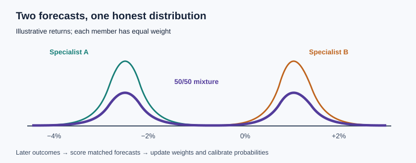

Two forecasts can agree on an average and disagree completely on the risk. One analyst expects a stock to return −2% and another expects +2%. Their average is zero, but zero may be the least likely outcome. A useful combination keeps the disagreement visible, then checks whether its stated odds match what happens later.

*A mixture carries both the uncertainty within each forecast and the distance between them.*

**In brief:** Blend full distributions when their differences matter. Learn weights and probability corrections from forecasts made before their outcomes, then test the result on later dates. [Why use it?](#why-use-it) · [How it works](#how-it-works) · [The math](#the-math) · [OakQuant](#where-oakquant-uses-it) · [Public use](#where-it-is-used-elsewhere) · [Alternatives](#alternatives-and-tradeoffs) · [Further reading](#people-libraries-and-further-reading)

## Why use it?

A single mean cannot tell a reader whether forecasters cluster around a small return or split between a gain and a loss. That distinction changes the chance of a gain and the width of a return range. A weighted **predictive mixture** preserves each member's distribution, including its tails. Calibration asks a separate question: among forecasts that said “70% chance,” did the event occur about seven times in ten? A model can rank opportunities well and still give unreliable probabilities. [Gneiting and Raftery explain why predictive distributions need proper scoring rules](https://sites.stat.washington.edu/people/raftery/Research/PDF/Gneiting2007jasa.pdf).

If the members make nearly identical forecasts, or the record is too short to estimate weights, a simple baseline or equally weighted average may be more defensible. Complexity earns its place only when it improves scores on later, untouched cases.

## How it works

First, define one target: for example, a stock's split-adjusted return over the next five trading sessions. Each specialist must forecast that same target using only information available at issue time. A specialist may supply a full distribution or a set of quantiles with a stated interpolation and tail rule. A point estimate alone is insufficient to recover its uncertainty.

Next, issue and freeze the forecasts. Once the five-session outcomes settle, score members on *matched* opportunities. A specialist that sat out difficult dates should not be rewarded for a cleaner score. Fit weights on earlier dates, reserve later dates for calibration, and keep a final block untouched for evaluation. Shared market shocks make adjacent forecasts dependent, so count effective support by date and horizon rather than treating every stock-date row as an independent trial.

Blend the distributions, then derive the expected return, chance of gain, and desired quantiles from that one result. If a probability correction changes the chance of gain, adjust the underlying distribution too: one possible method preserves the conditional return shapes above and below zero while changing their shares. Recompute the quantiles afterward. Check event reliability and interval coverage separately. A 90% interval should contain about 90% of comparable settled outcomes, but coverage alone says little if the interval is needlessly wide. [Gibbs and Candès study adaptive conformal coverage under changing conditions](https://arxiv.org/abs/2106.00170); their guarantee is not a promise of exact coverage in every market sector.

## The math

Let $R$ be the future return, $F_m(r)=P_m(R\le r)$ specialist $m$'s cumulative distribution, and $w_m\ge0$ its weight, with $\sum_m w_m=1$. The mixture is

$$
F(r)=\sum_m w_mF_m(r).
$$

For two equally weighted specialists with means $\mu_1=-2$ and $\mu_2=+2$ **percentage points**, each with variance $\sigma_m^2=1$ **squared percentage point**, the mixture mean is $\mu=0$. The law of total variance gives

$$
\operatorname{Var}(R)=\sum_m w_m\left[\sigma_m^2+(\mu_m-\mu)^2\right]
=\tfrac12(1+4)+\tfrac12(1+4)=5\text{ squared percentage points}.
$$

One unit comes from uncertainty within specialists and four from their disagreement. Averaging two separately reported interval endpoints need not produce the mixture's interval; take quantiles from $F$ itself. In this symmetric example, assuming both specialists use normal distributions, $P(R>0)=0.5$. Normality is an illustrative assumption, not an observed market fact.

Weights can respond to a settled loss $\ell_{m,t}$ through the Hedge update

$$
w_{m,t+1}=\frac{w_{m,t}\exp(-\eta\ell_{m,t})}{\sum_j w_{j,t}\exp(-\eta\ell_{j,t})},
$$

where $t$ indexes eligible settled opportunities and $\eta\ge0$ controls the update speed. With two equal starting weights, losses $0.1$ and $0.3$, and $\eta=1$ in reciprocal loss units, the new weights are approximately $0.550$ and $0.450$. This is a method, not evidence that such weights improve OakQuant forecasts. Delayed outcomes require the update to wait until the horizon closes. [Joulani, György, and Szepesvári analyze delayed feedback](https://proceedings.mlr.press/v28/joulani13.html).

For an event probability $p$ and realized indicator $y\in\{0,1\}$, Brier loss is $(p-y)^2$. For the entire return distribution, the continuous ranked probability score is $\int_{-\infty}^{\infty}[F(r)-\mathbf1\{R\le r\}]^2dr$, where $\mathbf1$ is the event indicator and lower is better. The latter has units of return. Score the blend against a baseline and its strongest individual member on the same held-out opportunities. [Gneiting and Raftery give the scoring-rule framework](https://sites.stat.washington.edu/people/raftery/Research/PDF/Gneiting2007jasa.pdf).

## Where OakQuant uses it

The current local code contains **replayable library primitives**, not evidence that a qualified mixture is serving every investor. `cambium/adapt/online_mixture.py` computes matched-opportunity, date-balanced CRPS weights for return distributions and can fall back to an incumbent when support is insufficient. `cambium/adapt/cohort_calibration.py` fits chronologically separated, partially pooled conditional calibration and checks issue-time availability. `timber/common/services/judgment/calibration.py` provides Brier and reliability measurements. The investment domain owns forecast production; `oak-forecast` owns evaluation tools. These are distinct from a demonstrated, held-out improvement in live market forecasts.

The current [v2 forecasting plan](../FABLE_52_ML_PLAN.md) proposes a common target, online combination, recomposition, and a calibrated distribution per stock and horizon. That end-to-end publication path remains a **proposed design** until its wiring and market qualification are verified. Shared market training must use authorized market evidence; a customer's private portfolio is a separate input for personal decisions, not training material for a shared model.

## Where it is used elsewhere

The European Centre for Medium-Range Weather Forecasts publishes ensemble forecasts to express alternative weather outcomes and their probabilities. Its [Forecast User Guide](https://confluence.ecmwf.int/pages/viewpage.action?pageId=283544832) describes verification of probability accuracy and statistical post-processing of ensemble output, including optimization against CRPS. Weather and equity returns have different data-generating conditions; the public example documents the forecasting method, not transferable financial performance.

## Alternatives and tradeoffs

| Approach | Useful when | What it gives up or risks |
|---|---|---|
| Single baseline | Few settled examples; a transparent reference is needed | Misses useful specialist differences. |
| Equal-weight distribution mix | Specialists share a target but skill estimates are noisy | Weak members retain influence; correlated mistakes can dominate. |
| Performance-weighted mixture | Matched, out-of-sample losses provide enough support | Weights can chase a recent regime; calibration and interval quality still need checking. |
| Stacked point forecast | Only expected return matters and validation data are adequate | A point estimate cannot by itself yield honest tail odds or a return interval. |
| Conformal interval around a forecast | Coverage is the immediate goal | Coverage does not supply a full distribution or event probability; conditional coverage is difficult with sparse segments. [Barber and colleagues examine this limit](https://arxiv.org/abs/1903.04684). |

## People, libraries, and further reading

Start with [ECMWF's probability verification guide](https://confluence.ecmwf.int/pages/viewpage.action?pageId=283544832) for a public working example. For the theory, Tilmann Gneiting and Adrian Raftery's [paper on proper scoring rules](https://sites.stat.washington.edu/people/raftery/Research/PDF/Gneiting2007jasa.pdf) connects reliability to scoring full distributions. Nicolo Cesa-Bianchi and Gábor Lugosi's [prediction-with-expert-advice text](https://www.cambridge.org/core/books/prediction-learning-and-games/5B3D68B4056A87D7E03EE9A38E1A66A3) develops online weighting; [Joulani, György, and Szepesvári](https://proceedings.mlr.press/v28/joulani13.html) handle delayed observations.

For public software, [scikit-learn's calibration documentation](https://scikit-learn.org/stable/modules/calibration.html) explains sigmoid and isotonic probability correction, while [SciPy's distribution interface](https://docs.scipy.org/doc/scipy/reference/generated/scipy.stats.rv_continuous.html) is a starting point for working with continuous distributions. These are learning resources, not claims that OakQuant imports either library for this pipeline.

[Building a Brain](/public/articles/building-a-brain) · [Learning from outcomes](/public/articles/brain-learning-from-outcomes) · [Point-in-time memory](/public/articles/brain-point-in-time-memory)
