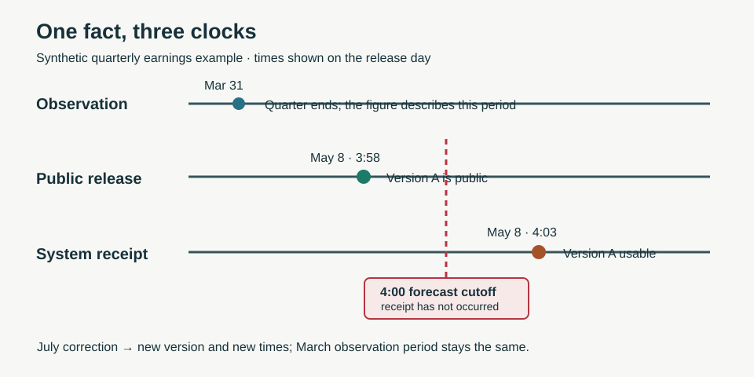

At 3:58 p.m., a company files an earnings report. A research system receives the feed at 4:03. At 4:00, it issues a forecast. Which earnings figure belonged in that forecast?

The answer depends on the question. A study of what the public *could* have known may include the filing. A replay of what this particular system *did* know must exclude it. Data provenance keeps those claims apart. Cost control then asks which additional evidence is worth fetching, storing, or sending to a model.

*One number can describe an old quarter, become public today, and reach a system later still. The chosen cutoff decides whether it is eligible.*

**In brief:** Keep each version with its source and availability time; reuse an eligible snapshot before paying for another fetch or model call. The price is more storage and stricter bookkeeping.

**Contents:** [Why use it?](#why-use-it) · [How it works](#how-it-works) · [The math](#the-math) · [Where OakQuant uses it](#where-oakquant-uses-it) · [Where it is used elsewhere](#where-it-is-used-elsewhere) · [Alternatives and tradeoffs](#alternatives-and-tradeoffs) · [People, libraries, and further reading](#people-libraries-and-further-reading)

## Why use it?

A current database is excellent at answering what it says *now*. It can be a poor witness to what it said last month. Companies restate accounts; statistical agencies revise estimates; vendors correct prices. If an old value is overwritten, a backtest may quietly use a correction that did not exist when the forecast was made. The [St. Louis Fed's ALFRED real-time periods](https://fred.stlouisfed.org/docs/api/fred/realtime_period.html) make the difference visible: they let a reader ask for an earlier vintage rather than today's revised value.

The same discipline prevents waste. A verified, fresh record may already answer a question. Another provider call adds cost and latency without adding information. But a cheap, stale snapshot is no bargain if the task requires today's price. For a simple current display with no historical replay, a conventional cache and a visible freshness timestamp may suffice.

## How it works

Take a **synthetic** quarterly profit figure. The quarter ends March 31. Version A is released May 8 at 3:58 p.m. and reaches the system at 4:03. Version B corrects the figure in July. The March period describes *what* was measured; the May and July release times describe *when each version became public*; the receipt times describe *when this system could use each version*. Neither the quarter end nor the July correction may be substituted for the May receipt in a 4:00 p.m. system replay.

A practical record needs an issuer ID, metric, value, units, observation period, source, source record ID, version, publication time when available, receipt time, and any validation or approval time. A forecast also needs its cutoff and the IDs of the input versions it used. Date-only sources require an explicit conservative rule; they cannot support a minute-precise replay merely because the database stores a timestamp. The [SEC's EDGAR APIs](https://www.sec.gov/search-filings/edgar-application-programming-interfaces) supply public filing histories and XBRL facts, including units and reporting periods, but a consumer still has to record its own receipt and interpret any later correction.

The ingestion path checks identity, currency, adjustment convention, units, and errors before the value enters a feature. Zero profit is a value; a missing filing is absence; a failed feed is an error. Those states should not collapse to the same zero. Repeated deliveries can share one event identity while retaining their separate source receipts. A new figure is a new version. Near-duplicate matching needs labeled examples because a false merge can hide a real second event.

For each request, the system can ask: does a stored version cover the required field and time, meet the freshness rule, and permit this use? If so, reuse it. If not, fetch the smallest missing part from an eligible source. A license to display data does not automatically grant training or redistribution rights; that is a contract question, not a property inferred from a cache hit.

## The math

For a system replay at cutoff \(T\), select the latest eligible version \(v\) of a particular fact:

$$
v^*(T)=\underset{v}{\operatorname{arg\,max}}\;a_v
\quad\text{subject to}\quad
a_v\le T,\;p_v\le T,\;q_v=1.
$$

Here \(a_v\) is the time version \(v\) became usable by this system (at least its receipt time, and later if validation was required), \(p_v\) is its public release time when a public-information claim matters, and \(q_v\) is 1 only when the version passes the relevant quality and permission checks. This chooses among versions of the *same fact*, not the most recent value across unrelated quarters. For a public-information study, use a documented public-release rule rather than system availability. At 4:00 p.m. in the opening example, the 4:03 receipt fails \(a_v\le T\).

Cost has a similarly plain calculation. If source A costs \(c_A\) per attempt and returns an acceptable answer with probability \(s_A\), and a guaranteed backup costs \(c_B\), then trying A once before B has expected spend

$$
E[C]=c_A+(1-s_A)c_B.
$$

With synthetic prices of 1 cent, 50% success, and a 3-cent backup, that is \(1+0.5(3)=2.5\) cents per request, versus 3 cents for the backup alone. The 0.5-cent saving assumes the backup succeeds and ignores extra latency, repair work, and contractual restrictions. If the backup can fail too, this is **cost per attempt**, not cost per usable record. A real vendor choice should compare matched requests and count those other costs.

For model calls, input and output prices may differ. A simple usage estimate is \(C_{\text{model}}=(n_{\text{in}}r_{\text{in}}+n_{\text{out}}r_{\text{out}})/10^6\), where token counts are \(n\) and rates \(r\) are dollars per million tokens. A shorter payload lowers only the input term unless it also changes the response. No token saving proves that the answer stayed as good; that requires a task-level check.

## Where OakQuant uses it

The current code places market-data fetching and the DB-backed `StockDataSnapshot` read-through cache in **`oak-domain-investments`**, a domain package. The cache stores fetched snapshots as new rows, records the answering source, applies metric-specific freshness limits, and can fall back to bounded stale data when a vendor fails. **Timber** supplies shared database and learning primitives; it no longer owns the investment fetchers. In the investment forecast path, recorded macro and news observations have `observed_at` and `available_at` values, and input alignment excludes observations after the cutoff. A price-receipt builder also records provider, adjustment convention, session, and collection time. These are concrete pieces of provenance, not a claim that every feed has a complete three-clock audit trail or that every historical vendor revision can be reconstructed.

**Cambium** supplies payload preparation and a cost ledger. Its `resolve` runner tries cheaper resolver tiers first and gates a generative tier against a budget. **Acorn** calls Cambium's distillation and usage accounting at its model boundary; its import fallback can pass the payload through if Cambium is unavailable. This is model-computation cost control, distinct from the investment package's vendor selection and cache. A universal license-aware feed broker, matched vendor-value evaluation, and complete release/receipt/version capture across all sources remain design goals in this article, not verified live behavior. The current forecast input path draws on recorded market, macro, and news observations; it does not add private household records to those shared market inputs.

## Where it is used elsewhere

The [Federal Reserve Bank of St. Louis](https://fred.stlouisfed.org/docs/api/fred/realtime_period.html) documents real-time periods for economic observations and exposes earlier information vintages through ALFRED. That supports a public-information replay for those series. It does not establish when a separate research system received a response. The [SEC EDGAR data APIs](https://www.sec.gov/search-filings/edgar-application-programming-interfaces) expose submissions and company facts; their documentation describes updates as filings are disseminated. A consumer must still preserve the version and receipt it used. These institutions show why a published source history and a local ingestion history serve different purposes.

## Alternatives and tradeoffs

| Approach | Useful when | What it gives up | Failure to watch |
|---|---|---|---|
| Current-value table and time-to-live cache | Only a fresh display is needed | Earlier versions and replay | A correction silently rewrites the past |
| Append-only receipts with as-of selection | Forecast replay and audit matter | More storage, indexing, and source-specific rules | A missing or guessed availability time makes replay overconfident |
| Provider-supplied historical vintages | The source publishes version history, as ALFRED does | Coverage depends on that provider and its time granularity | Public vintage is mistaken for local receipt |
| Always fetch the premium source | Latency and reliability matter more than spend | Reuse and cheaper acceptable options | Extra expense without measurable information gain |
| Cheapest-first fetch with backup | Success rate and deadline permit a retry | An extra round trip on failure | Nominal price hides delay and repair cost |

No provenance scheme repairs a fact that was never collected. Nor do five vendor copies make five independent confirmations if all five copied one original release.

## People, libraries, and further reading

Temporal data has many contributors rather than one inventor. **Richard T. Snodgrass** surveyed the distinction between when a fact applies and when a database knows it in [*Temporal Databases*](https://www2.cs.arizona.edu/~rts/pubs/LNCS639.pdf). **Ralph Kimball** described the related warehouse practice of adding a row rather than overwriting history in [Type 2 slowly changing dimensions](https://www.kimballgroup.com/2008/09/slowly-changing-dimensions-part-2/). These are useful foundations, though financial release and receipt times need their own domain rules.

For a practical first stop, inspect [ALFRED's real-time-period guide](https://fred.stlouisfed.org/docs/api/fred/realtime_period.html) and ask what its vintage date does—and does not—prove. [pandas `merge_asof`](https://pandas.pydata.org/pandas-docs/stable/reference/api/pandas.merge_asof.html) provides a backward time join for a local prototype; the caller must still filter by entity, version eligibility, and permissions. [Apache Iceberg's snapshot documentation](https://iceberg.apache.org/docs/latest/maintenance/) describes table time travel, while [OpenLineage's specification](https://github.com/OpenLineage/OpenLineage/blob/main/spec/OpenLineage.md) describes run and dataset lineage. Both are public implementation resources, not claims that OakQuant uses those libraries. For a deeper account of the public data itself, read the [SEC EDGAR API documentation](https://www.sec.gov/search-filings/edgar-application-programming-interfaces).
