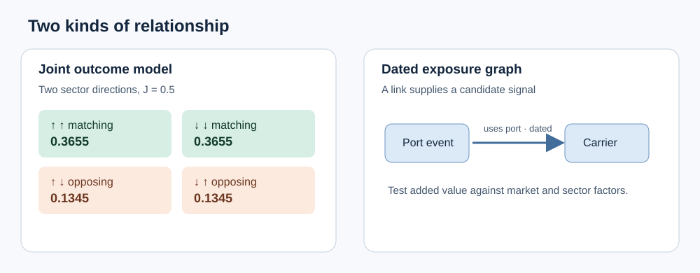

A port closes for two days. The carrier serving it falls, but so do a fuel supplier and a retailer waiting on inventory. Were those three moves connected, or did a broad market selloff move them together? A model that forecasts each company in isolation cannot answer that question.

Two tools address different parts of it: an **energy model** assigns probabilities to combinations of outcomes; a **relationship graph** records which entities can pass a disruption to which others. Neither turns a business link into a proven price effect.

*Joint states and commercial links answer different questions; both need an outcome test against simpler explanations.*

**In this article:** [Why use it?](#why-use-it) · [How it works](#how-it-works) · [The math](#the-math) · [Where OakQuant uses it](#where-oakquant-uses-it) · [Where it is used elsewhere](#where-it-is-used-elsewhere) · [Alternatives and tradeoffs](#alternatives-and-tradeoffs) · [People, libraries, and further reading](#people-libraries-and-further-reading)

## Why use it?

Suppose two sector forecasts each say “50% chance of a gain.” That says nothing about the chance of *both* gaining. A portfolio exposed to both needs the joint probability. An energy model can represent it directly, including patterns that independent forecasts miss.

A graph helps with a separate omission: a company may depend on a port or supplier outside its industry group. Dated edges make those relationships available as candidate features. If a market factor, sector average, or simple neighbor average explains the same outcome, the more elaborate model has no earned role.

## How it works

For a small energy model, first choose a forecast cutoff and a common horizon. Convert each sector's future residual return direction into +1 or −1, where “residual” means return after a specified market or sector benchmark. Fit the model only on observations that would have been available before each historical cutoff. At inference, score every possible direction combination and normalize the scores into a joint distribution. This is a distribution over **directions**, not dollar losses or return magnitudes.

In an invented two-sector example, each direction remains equally likely on its own, yet the two sectors usually move together. The model can capture that dependence without claiming that either sector causes the other to move. For eight binary sectors there are 256 combinations, so exact summation is still feasible. Each additional sector doubles that count.

A relationship graph starts with entities as nodes and timestamped, typed links as edges: *supplier of*, *customer of*, or *uses port*. Node features might be a lagged disruption indicator and a measured exposure. A basic model averages available neighboring signals; a graph neural network learns how to transform and combine them. A supplier event is an observed input only if its publication time precedes the forecast. The strength and direction of any price effect remain hypotheses to test. [Kipf and Welling's graph convolution paper](https://arxiv.org/abs/1609.02907) describes one way to aggregate neighboring nodes.

## The math

For two sector signs $s_1,s_2\in\{-1,+1\}$, an Ising energy with no individual direction bias is

$$
E(s_1,s_2)=-Js_1s_2,\qquad
P(s_1,s_2)=\frac{e^{-E(s_1,s_2)}}{Z},\qquad
Z=\sum_{u,v\in\{-1,+1\}}e^{-E(u,v)}=2e^J+2e^{-J}.
$$

Here $J$ is a fitted coupling, $E$ is a score whose lower values receive more probability, $P$ is the normalized joint probability, and $Z$ is the sum over all four states. At $J=0.5$, $Z\approx4.5105$. Each matching pair has probability $e^{0.5}/Z\approx0.3655$; each opposing pair has $e^{-0.5}/Z\approx0.1345$. Thus matching directions have probability $2(0.3655)\approx0.7311$, while each sector's own gain probability remains $0.5$. [Wainwright and Jordan](https://doi.org/10.1561/2200000001) develop the normalization and inference framework for graphical models.

A graph layer can be written as

$$
h_i^{(k+1)}=\sigma\!\left(W_0h_i^{(k)}+\sum_{j\in N_t(i)}a_{ji,t}W_{r(j,i)}h_j^{(k)}\right).
$$

$h_i^{(k)}$ is entity $i$'s feature vector after layer $k$; $N_t(i)$ contains neighbors whose links were known at cutoff $t$; $a_{ji,t}$ is a measured or learned link weight; $W_0$ and $W_{r(j,i)}$ transform the company's own features and features from relation type $r$; $\sigma$ is a nonlinear function. A one-layer toy calculation with identity transforms, no nonlinearity, company signal 0.2, supplier signal 0.8, and a verified exposure weight 0.25 gives $0.2+0.25(0.8)=0.4$. That is a feature value, **not** a 40% return forecast. [PyTorch Geometric's message-passing guide](https://pytorch-geometric.readthedocs.io/en/latest/tutorial/create_gnn.html) documents this family of updates.

Judge the energy distribution by held-out **joint log loss**, $-\log P(s_{1,t},s_{2,t})$, averaged over later dates $t$. Score a graph-derived forecast against the same dated outcomes and baseline opportunities. Dates, rather than the four states enumerated on each date, set the effective sample of independent evidence.

## Where OakQuant uses it

The current [neural and energy investigation](../../../../ml-investigations/03-deep-energy.md) reports one implemented neural return predictor, `deep_v1`, and no registered energy return model. The [implementation plan](../../../../ML_IMPLEMENTATION_PLAN.md) places a small exact sector energy model and a residual relationship graph among **research challengers**. It proposes graph diffusion features before a graph neural network and requires the energy model to beat independent marginals and a factor or copula baseline on frozen future folds. This is a design plan, not a deployed OakQuant forecast capability.

If the candidates qualify, reusable model and data primitives belong in Timber; Grove would select and orchestrate qualified behavior through configuration, while Cambium handles cost-aware model resolution. Dated relationship records must preserve source and availability time. Customer portfolio data must not silently become shared market-training data. Neither a graph edge nor an energy score should reach a customer-facing return forecast without matched, held-out evidence of incremental value.

## Where it is used elsewhere

A documented production graph example comes from a different domain. [Google DeepMind describes](https://deepmind.google/blog/traffic-prediction-with-advanced-graph-neural-networks/) a graph neural network used with Google Maps traffic data to estimate future travel times for connected road segments and rank candidate routes by ETA. Roads have physical connectivity and observed traffic; supplier relationships and stock returns require a separate validation contract. This example establishes that graph message passing can work in a deployed system, not that it forecasts securities.

## Alternatives and tradeoffs

| Approach | Useful when | Gives up or can fail |
|---|---|---|
| Independent sector probabilities | Dependence is weak or data are sparse | Misses joint shocks; deceptively narrow portfolio scenarios |
| Gaussian factor or copula model | A few shared drivers explain dependence | Can miss state-specific or asymmetric interactions; assumptions need tail checks |
| Small exact energy model | Joint *binary* states matter and enumeration is tractable | State count doubles per added sign; directions omit loss size |
| Sector or neighbor average | Exposures are coarse or link data unreliable | Blurs which entity transmitted a shock |
| Dated graph model | Reliable typed links and repeated propagation outcomes exist | Stale or missing edges, common shocks, and extra capacity can create false skill |

A hidden-unit model such as a restricted Boltzmann machine can learn more complex joint representations, but adds fitting and sampling diagnostics. Its reconstruction quality is not evidence of future return skill. [Hinton's practical guide](https://www.cs.toronto.edu/~hinton/absps/guideTR.pdf) is a useful introduction to those difficulties. A high density score alone is also an unsafe novelty alarm: [Nalisnick and colleagues](https://arxiv.org/abs/1810.09136) show counterexamples for density models.

## People, libraries, and further reading

Ernst Ising's name is attached to the binary-interaction model; [Wainwright and Jordan's survey](https://doi.org/10.1561/2200000001) is the deeper mathematical route into modern graphical models. Geoffrey Hinton's [RBM training guide](https://www.cs.toronto.edu/~hinton/absps/guideTR.pdf) covers hidden-unit energy models. Thomas Kipf and Max Welling's [graph convolution paper](https://arxiv.org/abs/1609.02907) is a practical starting point for neighborhood aggregation.

For implementation study, [PyTorch Geometric](https://pytorch-geometric.readthedocs.io/en/latest/tutorial/create_gnn.html) documents message passing, and [scikit-learn's GaussianMixture](https://scikit-learn.org/stable/modules/generated/sklearn.mixture.GaussianMixture.html) offers a simpler distributional comparator. These are public learning tools, not claims about OakQuant's installed dependencies.
