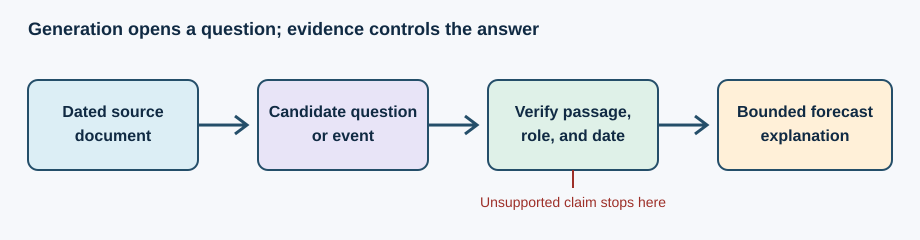

A shipping terminal closes before the market opens. A company filing mentions the terminal, but says nothing about how much cargo could move elsewhere. An analyst needs to know what to investigate before making a forecast. A language model can draft that list of questions quickly; it cannot turn the missing capacity figures into observed facts.

That is the useful role of generative capability here: widen the search for plausible explanations, then speak clearly about conclusions established by other evidence. The distinction matters most when the prose sounds more certain than the records permit.

*Generation proposes; source checks and numerical models decide what can become a forecast claim.*

**In brief:** Use generation for open-ended questions and readable synthesis. Keep source verification, numeric computation, and permission checks in explicit steps. [Why use it?](#why-use-it) · [How it works](#how-it-works) · [The math](#the-math) · [OakQuant](#where-oakquant-uses-it) · [Public use](#where-it-is-used-elsewhere) · [Alternatives](#alternatives-and-tradeoffs) · [Reading](#people-libraries-and-further-reading)

## Why use it?

A fixed report can display a probability and a return range perfectly well. Generation becomes useful when a reader asks a new question, such as which suppliers a disruption might affect, or wants a concise explanation drawn from several permitted records. It can propose scenarios that a narrow forecasting model was never built to enumerate. A scenario is a conditional story, not a probability estimate.

For routine numbers and repeated wording, a template is cheaper, easier to audit, and less likely to invent a source. The [NIST Generative AI Profile](https://www.nist.gov/publications/artificial-intelligence-risk-management-framework-generative-artificial-intelligence) calls confidently presented false output *confabulation*, including false citations. Fluency is therefore a reason to check the claim, not evidence that it is true.

## How it works

A common language model assigns probabilities to the next token, a piece of text, given the tokens already present. It repeats this step to make a sentence. The Transformer introduced by [Vaswani and colleagues](https://arxiv.org/abs/1706.03762) uses attention to relate positions in a sequence. That machinery is powerful at forming text; next-token prediction alone does not verify a filing or estimate a five-day return distribution.

Consider a synthetic port-closure notice. The model proposes: “Did Carrier A divert ships?” A researcher retrieves a dated filing or operational notice and records the passage, company, event date, and role. If the passage says only that Carrier A *may* divert ships, the event remains a plan, not a completed diversion. A structured extractor could help produce candidate records, but each candidate needs an evidence check before it becomes a feature.

For a forecast explanation, start instead with a saved forecast: target, horizon, probability, interval, cutoff time, and approved source facts. Compute and lock the numbers in code. Give the generator only the facts needed for the requested explanation. Then check its factual assertions and numeric strings against the saved record. If a check fails, a fixed template can display the forecast and its limits. This is a proposed publication contract, not a claim that every check is already deployed.

A historical evaluation must also respect time. The document must have been available by the forecast cutoff. A modern model may have seen later events in pretraining, so replaying old documents through it does not by itself demonstrate a hindsight-free signal. A frozen extractor, dated inputs, and a forward test provide stronger evidence.

## The math

For a token sequence \(x_1,\ldots,x_T\), an autoregressive model assigns

$$
p(x_1,\ldots,x_T)=\prod_{t=1}^{T}p(x_t\mid x_1,\ldots,x_{t-1}).
$$

Here \(x_t\) is token \(t\), and the right-hand factor is its conditional probability given earlier tokens. This equation describes text generation. It is **not** the probability that a proposed business event occurred.

An extractor needs a separate test. Let \(TP\) be true positive event flags, \(FP\) false flags, and \(FN\) missed events. Then

$$
\text{precision}=\frac{TP}{TP+FP},\qquad
\text{recall}=\frac{TP}{TP+FN}.
$$

Suppose a labeled sample contains 15 real closure passages. The extractor flags 12 passages, 9 correctly. Then \(TP=9\), \(FP=3\), and \(FN=6\): precision is \(9/12=0.75\); recall is \(9/15=0.60\). Inspect the three false flags and six misses by role, date, and “planned versus completed” status. Only then test whether adding the feature improves forecasts on later, held-out outcomes. Extraction quality and forecast value are different measurements.

## Where OakQuant uses it

In the current local code, **Acorn** is the agent front door. Its `services/cambium_gateway.py` exposes `distill_context` to reduce prompt payloads and `record_usage` to account for model calls. `acorn/agents/oracle_agent.py` calls that gateway before parts of its model interaction. **Cambium** implements the reusable routing and cost primitives: `ASSEMBLE` skips a model when formatting is deterministic; other routes pass or reduce context before a possible model call. The gateway has an import fallback, so this code inspection alone does not prove which route a deployed request took.

A filing-event extractor, a source-by-source explanation validator, and a forward test of extracted features are **research and product designs** in this article. The inspected code does not establish them as live forecast capabilities. They would belong behind explicit data, workflow, and permission boundaries: shared market research uses permitted market documents; a private household record serves its authorized user and does not become shared market-model training data. A generative step can describe a forecast, but the forecast calculation and household decision rules need their own evidence and checks.

## Where it is used elsewhere

[Morgan Stanley announced](https://www.morganstanley.com/press-releases/key-milestone-in-innovation-journey-with-openai) an internal assistant for financial advisers that synthesizes the firm's own content and links answers to source documents. Its [2024 Debrief announcement](https://www.morganstanley.com/press-releases/ai-at-morgan-stanley-debrief-launch) also describes meeting notes and action items generated with client consent. These are documented language and retrieval uses. They are not evidence that generative text predicts returns.

## Alternatives and tradeoffs

| Approach | Best use | What it gives up | Failure to watch |
|---|---|---|---|
| Fixed template | Repeated forecast fields and standard caveats | Little flexibility for new questions | A stale or incomplete template |
| Rules or conventional entity extraction | Known event types in regular documents | May miss unfamiliar wording and relationships | Negation, dates, and “planned” events misclassified |
| Retrieval plus generation | Questions spanning approved, changing documents | More cost and validation work | Retrieved passage is irrelevant or answer exceeds it |
| Unrestricted generation | Early brainstorming | No dependable grounding | Invented facts, numbers, or citations |

Retrieval can provide relevant passages to a generator; it does not certify the resulting sentence. The original [retrieval-augmented generation paper](https://arxiv.org/abs/2005.11401) studies that combination as a language-generation method. For consequential claims, compare the final text with the actual passage and saved numeric record.

## People, libraries, and further reading

**People.** [Ashish Vaswani and coauthors](https://arxiv.org/abs/1706.03762) introduced the Transformer architecture. [Patrick Lewis and coauthors](https://arxiv.org/abs/2005.11401) developed a notable retrieval-augmented generation formulation. Neither group invented the broad practice of proposing questions with language models.

**Libraries.** [Hugging Face Transformers generation documentation](https://huggingface.co/docs/transformers/main_classes/text_generation) is a practical first stop for token-generation controls. [spaCy's entity and rule-matching documentation](https://spacy.io/usage/linguistic-features) shows a simpler path for known extraction tasks. These are public learning resources, not claims about OakQuant dependencies.

**Read deeper.** Start with the [NIST Generative AI Profile](https://www.nist.gov/publications/artificial-intelligence-risk-management-framework-generative-artificial-intelligence) for failure modes, then read the [Transformer](https://arxiv.org/abs/1706.03762) and [retrieval-augmented generation](https://arxiv.org/abs/2005.11401) papers for the mechanisms.
