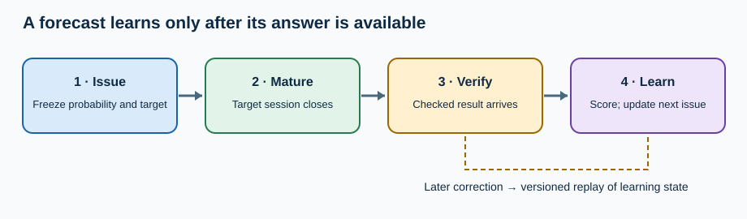

A forecaster puts a 60% chance on an index finishing higher after five trading sessions. Two sessions later, the index is up. That is tempting feedback, but it answers the wrong question. The test comes at the fifth close, and a checked closing value may arrive later still.

Learning from outcomes means preserving the prediction as issued, waiting for its specified result, scoring the pair, and changing future behavior under a recorded policy. It lets a system learn without rewriting what it once knew.

*Issue time, target time, and result availability time are separate gates in the feedback loop.*

**In brief:** The job is to turn forecasts into comparable evidence. The method is a time-ordered, versioned scorecard. Its cost is waiting for labels and preserving enough history to repair corrections.

[Why use it?](#why-use-it) · [How it works](#how-it-works) · [The math](#the-math) · [Where OakQuant uses it](#where-oakquant-uses-it) · [Where it is used elsewhere](#where-it-is-used-elsewhere) · [Alternatives and tradeoffs](#alternatives-and-tradeoffs) · [People, libraries, and further reading](#people-libraries-and-further-reading)

## Why use it?

A forecast cannot improve from a result that has not happened, and it should not improve twice from a result delivered twice. Both errors are easy to make when predictions have different horizons, feeds arrive late, and vendors issue corrections. [Joulani, György, and Szepesvári](https://proceedings.mlr.press/v28/joulani13.html) formalized how delayed feedback changes online learning: a learner must act while earlier answers are pending.

For an occasional forecast, a saved spreadsheet and fixed baseline may suffice. A service issuing many overlapping forecasts needs stable identities, availability times, and a repeatable update rule. The machinery earns its place only if it improves held-out results or reliability compared with that baseline.

## How it works

Start with a named question: for example, whether a synthetic stock's adjusted close after five trading sessions exceeds its issue-time adjusted close. A tie is a non-gain. That definition is a modeling choice; the eventual checked prices are observations. Keep the target, issue timestamp, target session, model and data versions, and probability exactly as sent. Changing those creates a new forecast.

At the target close, the result becomes *mature*, but it is usable only when its checked value becomes *available*. The scorer joins that value to the forecast's stable opportunity ID. Ten specialists predicting the same event produce ten paired scores from one outcome, not ten independent market events. Shared shocks and overlapping horizons further reduce independent evidence.

Apply the result once. A cursor and immutable retry payload make an interrupted job safe to resume. If a vendor revises the result, retain both versions and their availability times. Recompute the current scorecard from the correction, while preserving the forecasts as issued. A stateful learner may need to replay every later update in recorded order; replacing one score in a table can leave subsequent weights wrong.

An online update might change specialist weights. A larger refit might change features or parameters. Compare candidate and incumbent on the *same* mature cases, with a chronological split and untouched evaluation period. An updated policy affects future issues only. [Dawid's prequential approach](https://www.jstor.org/stable/2981683) judges predictions made before each observation was known.

## The math

For a binary event, Brier loss is

$$
\ell_i=(p_i-y_i)^2,\qquad \bar\ell=\frac{1}{N}\sum_{i=1}^{N}\ell_i.
$$

Here $p_i$ is the issued probability of a gain, $y_i$ is the checked outcome (1 for gain, 0 otherwise), and $N$ is the number of eligible, matched events. Lower is better. This is a [proper scoring rule](https://doi.org/10.1198/016214506000001437): in expectation, reporting one's true probability minimizes loss.

Suppose four forecasts each say 0.60 and their outcomes are 1, 1, 0, 0. The losses are 0.16, 0.16, 0.36, and 0.36, averaging **0.26**. A 0.50 baseline loses 0.25 on every case and wins this small comparison. With a rule that counts $p\geq0.50$ as a gain call, both get two calls right. Hit rate misses the difference. Four events demonstrate arithmetic, not durable skill.

For two specialists on the same event, define challenger advantage as $a_i=\ell_{\mathrm{incumbent},i}-\ell_{\mathrm{challenger},i}$. A positive value favors the challenger. Group comparisons by issue date and account for shared shocks before treating an average advantage as evidence. Squared error scores a predicted mean; a full return distribution needs a distributional score such as the [continuous ranked probability score](https://doi.org/10.1198/016214506000001437). These judge different claims.

## Where OakQuant uses it

**Implemented local primitives:** Cambium's `adapt` module has `forecast_loss` and `paired_loss`, which reject mismatched opportunities and outcomes unavailable before the horizon closes. Its `online_mixture.replay` accepts availability-ordered events, checks retry identity and revisions, and preserves issued forecast fields. `online_checkpoint` defines serialized, caller-transactional checkpoints. The Brier evidence routine balances dates and shrinks local evidence toward broader evidence; it explicitly does **not** calibrate probability. The return-mixture path uses CRPS. These capabilities exist in the current local `cambium/cambium/adapt/` tree; they do not establish production forecasting skill.

**Proposed policy and integration:** Cambium leaves storage and transaction ownership to a caller. The current [ML implementation plan](../../../../ML_IMPLEMENTATION_PLAN.md) treats online aggregation as a challenger to the constrained stacker and requires mature paired losses, delay-aware replay, independent evaluation, and qualification before promotion. An improved recent score alone does not switch the serving policy. Timber is the shared data and ML substrate; Grove can orchestrate changeable workflow behavior. Private household records are not training examples for a shared market model.

## Where it is used elsewhere

Weather services issue probabilities, wait for observations, and verify forecasts against those observations. The [ECMWF forecast user guide](https://confluence.ecmwf.int/spaces/FUG/pages/673551584/Section%2B8.3.5%2BUsing%2Bverification%2Bmetrics%2Bwith%2Bthe%2Boutput) documents Brier-score verification and reliability diagrams for ensemble probabilities. That is a documented public use of outcome scoring, not a claim that ECMWF uses OakQuant's update policy.

## Alternatives and tradeoffs

| Approach | Useful when | What it gives up | Failure to watch |
|---|---|---|---|
| Fixed baseline and periodic review | Few forecasts or little independent history | Slow response to real change | Persistent bias can go unnoticed |
| Batch refit on frozen history | Enough dated labels support a broad change | Fresh outcomes wait for the next fit | Leakage from revisions or future data |
| Versioned online updates | Many forecasts arrive and modest changes can be tested | More state, delay handling, and replay cost | Double application, noisy overreaction, immature labels |

The online method cannot manufacture evidence. A short record, correlated stocks, or specialists that predict different subsets may leave a weight change unjustified. A refit is a candidate that must pass a prospective comparison.

## People, libraries, and further reading

Glenn W. Brier's [1950 paper](https://doi.org/fp62r6) introduced the probability score bearing his name. Tilmann Gneiting and Adrian E. Raftery's [review](https://doi.org/10.1198/016214506000001437) is the deeper guide to proper scoring. A. P. Dawid developed the [prequential view](https://www.jstor.org/stable/2981683); Pooria Joulani, András György, and Csaba Szepesvári studied [delayed feedback](https://proceedings.mlr.press/v28/joulani13.html).

For a first calculation, use [scikit-learn's `brier_score_loss` documentation](https://scikit-learn.org/stable/modules/generated/sklearn.metrics.brier_score_loss.html); check its binary versus multiclass scaling. For incremental learning, [River's official documentation](https://github.com/online-ml/river) is a practical starting point. These are learning resources, not claims about OakQuant dependencies.
