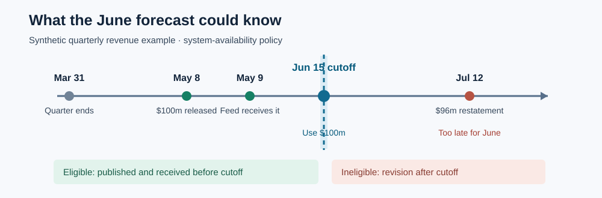

At 10:03 a.m., an analyst issues a forecast. A company filed its results at 10:01, but the analyst's data feed did not deliver them until 10:04. A backtest run months later can see the filing plainly. The analyst could not. If the backtest includes it, the model gets credit for a decision nobody could have made at 10:03.

**Point-in-time memory reconstructs the evidence available at a decision's exact cutoff, including which version of each fact had arrived.** It is useful whenever data are published late, revised later, or delivered to different systems at different times.

*A quarter's date says what a figure measures. Release and receipt dates determine when a forecast could use it.*

**In brief:** Keep immutable versions; select only those available by the cutoff; train only on outcomes already settled. The price is more storage, stricter data contracts, and sometimes fewer usable examples.

**Contents:** [Why use it?](#why-use-it) · [How it works](#how-it-works) · [The math](#the-math) · [Where OakQuant uses it](#where-oakquant-uses-it) · [Where it is used elsewhere](#where-it-is-used-elsewhere) · [Alternatives and tradeoffs](#alternatives-and-tradeoffs) · [People, libraries, and further reading](#people-libraries-and-further-reading)

## Why use it?

Suppose a research team asks whether a forecast issued on June 15 would have benefited from a company's first-quarter revenue. The quarter ended March 31. The company reported $100 million on May 8, the feed received it on May 9, and a July 12 restatement lowered it to $96 million. A database that overwrites the first value with the second will hand the June forecast a number from July. This is **look-ahead bias**: the historical test uses information that did not belong to the historical decision.

The problem extends beyond filings. Economic series are revised, index membership changes, and prices can be adjusted after a split. A row dated March 31 may describe March while having been published in May. A simple date filter cannot tell those clocks apart. The [St. Louis Fed's explanation of ALFRED](https://fred.stlouisfed.org/docs/api/fred/alfred.html) shows why retaining data vintages matters for real-time economic research.

If a source is immutable, arrives immediately, and is used only prospectively, a single event timestamp may be enough. The fuller record earns its cost when historical replay or delayed and revised data matter.

## How it works

Each observation needs an identity, a value and units, the period or event it describes, its public release time, its system receipt time, and its version. A quality gate can add another time: when the observation became approved for use. The release time answers what a member of the public could know; the receipt and approval times answer what this particular system could use. A **vintage** is one retained version of a value. Revisions are new versions, never silent edits to old ones.

For the synthetic revenue example, a June 15 system replay selects the $100 million May version. A June 15 replay cannot select July's $96 million restatement. A forecast issued before the May 9 receipt selects neither, even though the quarter ended in March. A historical *public-information* study could use the May 8 release after its actual publication time; it must say that its availability policy differs from the system replay.

An **as-of join** attaches the latest eligible feature to each forecast row. It matches the same company and measurement, checks the cutoff, applies a declared age limit, then chooses among eligible versions. A duplicate or conflicting version needs a deterministic tie rule or an error. If none qualifies, the feature is missing. A genuine zero remains zero; an unpublished figure, failed feed, and failed quality check must not be silently converted into the same observation. [Feast's historical feature retrieval](https://docs.feast.dev/v0.60-branch/getting-started/concepts/feature-retrieval) documents this class of point-in-time join.

The labels need the same care. A five-session return forecast cannot become a training example after one session: four sessions of its outcome remain open. In a **walk-forward test**, fit on earlier decisions, score a later block, then advance the cutoff. Remove, or *purge*, training rows whose outcome windows cross the test boundary. Check when each label became available; a fixed calendar gap alone cannot establish that. Fit scaling, feature selection, peer groups and model settings inside each training window so the test block cannot influence them. [Scikit-learn's leakage guidance](https://scikit-learn.org/stable/common_pitfalls.html#data-leakage) explains the preprocessing trap.

## The math

For observation version \(v\), let \(o_v\) be the event or reference time, \(p_v\) its public release time, \(r_v\) its system receipt time, and \(q_v\) the time it passed any required quality gate. If no gate applies, take \(q_v\) as no later than receipt. At decision cutoff \(t\), with maximum allowed age \(A\), a system-use version is eligible when

\[
E(v,t)=\mathbf{1}\!\left[o_v\le t\;\land\;\max(p_v,r_v,q_v)\le t\;\land\;t-o_v\le A\right].
\]

Here \(\mathbf{1}[\cdot]\) is one when every condition holds and zero otherwise. The age limit measures from the underlying observation, so a fresh restatement does not make an old event fresh. For versions of the same feature, choose the eligible observation with the latest reference time, then the latest available version under a declared tie rule. The function returns **missing** when the eligible set is empty.

Take \(t=\) June 15 and an age limit of 120 days. March 31 to June 15 is 76 days. The May version passes: its May 8 release and May 9 receipt precede the cutoff. The July version fails because July 12 is later than June 15. At a May 8 cutoff before receipt, both fail for this system. These dates and values are synthetic; the rule, rather than the revenue figure, is the point.

For training row \(i\), let \(s_i\) be its issue time, \(e_i\) its target-window end, and \(\ell_i\) the time its checked label became available. At a new fit cutoff \(T\), a conservative chronological rule admits the row only if \(s_i<T\), \(e_i<T\), and \(\ell_i<T\). The strict inequality avoids treating an outcome completed at the very instant of fitting as already reviewed. A later restatement may change future training, but it must not rewrite a forecast already issued.

## Where OakQuant uses it

OakQuant has **implemented pieces**, with different guarantees. Timber's `common.learning.point_in_time.align_inputs` aligns caller-supplied observations against timezone-aware cutoffs, keeps revisions as distinct observations, applies an optional age limit, and returns availability flags and provenance. Its `history_panel` builds price-based rows from supplied receipts and exchange sessions; `frozen_splits` excludes labels that cross train, tuning, calibration and holdout boundaries. The investment domain uses Timber's aligner in forecasting inputs and has a `PointInTimeView` for date-bounded price reads. `oak-forecast` provides an optional purged walk-forward evaluation path. These are local code capabilities, not a claim that every live forecast passes through one universal store.

There are limits to those capabilities. The generic aligner receives a caller-defined `available_at`; it does not independently recover public release or feed receipt times. The investment price view guards session dates, which alone cannot prove intraday availability or historical filing vintages. The current [v2 implementation plan](../FABLE_52_ML_PLAN.md) identifies the persisted, shared point-in-time feature and label store as a proposed S0 stage and lists filing-dated fundamentals, macro release vintages, and historical membership as gaps. For a full replay, those sources would have to supply trusted receipts and use the same feature definitions as live serving. Private customer records are outside this shared market-training design.

## Where it is used elsewhere

The [Federal Reserve Bank of Philadelphia's Real-Time Data Set for Macroeconomists](https://www.philadelphiafed.org/surveys-and-data/real-time-data-research/real-time-data-set-for-macroeconomists) publishes historical vintages so researchers can examine what economic data showed at earlier dates. The [St. Louis Fed's ALFRED API](https://fred.stlouisfed.org/docs/api/fred/realtime_period.html) exposes real-time periods for similar questions; its default FRED view shows today's information about the past. These archives document public data vintages. Neither, by itself, records when a particular firm's feed received a value.

## Alternatives and tradeoffs

| Approach | Useful when | What it gives up | Failure to watch |
|---|---|---|---|
| Latest-value table | Current dashboards and calculations | Earlier versions | A backtest silently inherits later revisions. |
| Date-only as-of join | Unrevised end-of-day observations with known timing | Publication and receipt precision | A March-period filing appears available in March. |
| Immutable vintages with release, receipt and quality times | Revised sources and auditable historical replay | Storage and ingestion simplicity | Missing or incorrect timestamps still create false history. |
| Fixed gap in time-series cross-validation | A quick baseline with uniform label delay | Per-row knowledge of label settlement | Late labels or overlapping windows slip through the gap. |

The featured method protects the chronology only as well as its source metadata. A vendor's backfilled “published” date is not proof that the data were delivered then. Missing histories can remain missing; point-in-time handling cannot manufacture old vintages.

## People, libraries, and further reading

Economists **Dean Croushore and Tom Stark** built and documented a real-time macroeconomic dataset and showed how revisions can change forecast evaluation. Their [Philadelphia Fed dataset page](https://www.philadelphiafed.org/surveys-and-data/real-time-data-research/real-time-data-set-for-macroeconomists) is a practical first stop; their [2001 paper, *A Real-Time Data Set for Macroeconomists*](https://bfi.uchicago.edu/wp-content/uploads/1.pdf), is the deeper account. Point-in-time data practice has no single inventor.

For implementation, [Feast's feature retrieval guide](https://docs.feast.dev/v0.60-branch/getting-started/concepts/feature-retrieval) explains historical feature joins; [DuckDB's `ASOF JOIN` documentation](https://duckdb.org/docs/stable/sql/query_syntax/from#as-of-joins) shows a lower-level temporal join; and [scikit-learn's `TimeSeriesSplit`](https://scikit-learn.org/stable/modules/generated/sklearn.model_selection.TimeSeriesSplit.html) supplies ordered splits and a configurable gap. These are public tools to study or use, not a list of OakQuant dependencies. Each still needs source-specific availability rules and label timing.
