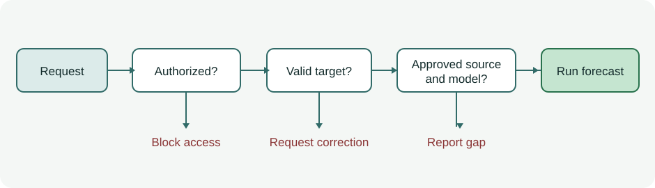

A market-data feed goes dark just before a forecast is due. Another feed has prices, but the caller's license does not cover it. Which path should the service take? An accurate model cannot answer the permission question, and a quick fallback could make the breach harder to spot.

A **rules engine** answers a narrower question: given these facts and this version of the policy, which action is allowed? Its value is a decision that can be tested and replayed before any forecast runs.

*The gates have different jobs: a usable feed never overrides missing permission.*

**In brief:** Rules enforce known constraints; they do not discover whether a market signal predicts returns. The tradeoff is that every exception and rule conflict must be designed and maintained.

**Contents:** [Why use it?](#why-use-it) · [How it works](#how-it-works) · [The math](#the-math) · [Where OakQuant uses it](#where-oakquant-uses-it) · [Where it is used elsewhere](#where-it-is-used-elsewhere) · [Alternatives and tradeoffs](#alternatives-and-tradeoffs) · [People, libraries, and further reading](#people-libraries-and-further-reading)

## Why use it?

Rules are useful when a condition must hold regardless of what a model predicts: permission, a valid target, sufficient evidence, or a bounded adjustment. The inputs and outputs are explicit enough to test at the boundary. A few stable checks can remain ordinary application code. A decision table earns its place when policy owners need to inspect many cases, version them, and see what happens when rows overlap.

A rule can enforce *how* a forecast is produced, but cannot establish that the forecast is good. A threshold such as “use a fallback after 15 minutes” needs tests at minute 15 and an outcome study to show whether it improves service. A rule that buys after a price jump is itself a market hypothesis and needs out-of-sample comparison.

## How it works

Start with a typed request: caller, requested instrument, forecast cutoff, target session, source status, and the policy version. Evaluate authorization before considering fallback data. Then check whether the target and forecast contract are valid. Finally, select a source and model that satisfy that same contract. Each step emits an action and a reason. An *unknown* permission is a block, not an implied allow; an unpublished price is distinct from a published value of zero.

Consider a synthetic five-session forecast. The caller is authorized for feed A, whose last acceptable price arrived at 15:50. The request arrives at 16:10 and the policy allows prices at most 15 minutes old. Feed A is 20 minutes old, so it fails. Feed B is current but unlicensed for this caller; it cannot serve as fallback. The result is **no forecast**, with both reasons recorded. If an approved feed C supplies a timely price and supports the same target, the policy may select it. The times, licenses, and source states are observed inputs; the 15-minute tolerance and fallback order are policy choices.

A decision table needs a **hit policy** for overlapping rows. Under *First*, the first matching row wins. Under *Unique*, more than one match is an error. Under *Collect*, several outputs are returned. These are different semantics, not formatting choices; the [OMG DMN 1.4 specification](https://www.omg.org/spec/DMN/1.4/) defines them. For a security gate, a deny-overrides rule is often clearer than relying on row order.

Replay requires the checked facts, their observation times, the rule and configuration versions, the matching rule IDs, and the result. Saving only “fallback used” loses the reason. A retry also needs an idempotent execution boundary: evaluating the same rule twice must not create two forecasts or count one settled outcome twice. If an outcome is revised later, retain the earlier version and reconcile any learning update explicitly. Those are design requirements, not properties a rules engine supplies automatically.

## The math

For a deny-overrides gate, let \(D_i(x)\) mean that deny rule \(i\) matches request \(x\), and \(A_j(x)\) mean that allow rule \(j\) matches. The authorization decision is

\[
\operatorname{allow}(x)=\left(\bigvee_{j=1}^{m} A_j(x)\right)\land\neg\left(\bigvee_{i=1}^{n} D_i(x)\right).
\]

Here \(m\) and \(n\) are the numbers of allow and deny rules, \(\bigvee\) means “at least one,” and \(\neg\) means “not.” With one matching allow and one matching deny, the result is false. With no matching rules, it is also false. This is the same broad precedence principle documented for [AWS IAM policy evaluation](https://docs.aws.amazon.com/IAM/latest/UserGuide/reference_policies_evaluation-logic_policy-eval-denyallow.html), though a forecast policy need not copy IAM's full policy model.

For source freshness, a separate predicate can be \(F(s,t)=\mathbf{1}[t-t_s\leq\Delta]\), provided the source timestamp \(t_s\) is known and the age is nonnegative. Here \(t\) is the decision time, \(\Delta\) is the maximum allowed age, and \(\mathbf{1}\) is one when its condition holds. At 16:10, a 15:50 observation has age 20 minutes: \(F=0\) for \(\Delta=15\) minutes. A missing timestamp must be handled as *unknown* and rejected by the policy, not coerced to zero age.

## Where OakQuant uses it

Current local code has a concrete rule implementation in `cambium/cambium/timber/rules.py`. A `RulesPackage` applies versioned checks and can return violations; its bundled reasoner checks include an adjustment ceiling, permitted cited dimensions, and a text filter. The ceiling and dimension checks can repair a payload and recheck it. This is a bounded output guard, not the forecast authorization table in the example.

Grove's configuration registry maps `decision` to `GroveDecisionConfig` in `grove/service/heartwood/config/config_models.py`. That establishes a home for changeable decision policy; the registry entry alone does not prove that the particular feed, target, or settlement gates described above are deployed. For OakQuant's architecture, reusable rule primitives belong in a shared package, changeable policy in Grove configuration, and caller identity at the Canopy boundary. The proposed forecast gates should be read as a design pattern until their configured rows, execution path, and tests are verified. Private household data does not become shared market-training data by passing through a rule.

## Where it is used elsewhere

[AWS IAM](https://docs.aws.amazon.com/IAM/latest/UserGuide/reference_policies_evaluation-logic_policy-eval-denyallow.html) publicly documents a real policy evaluator: requests start implicitly denied, require an applicable allow, and an explicit deny overrides an allow. This is an access-control use, not a claim about AWS forecasting. [Camunda's DMN documentation](https://docs.camunda.io/docs/components/modeler/dmn/decision-table-hit-policy/) shows how decision-table hit policies handle overlapping rows, including the fact that a Unique-table overlap fails evaluation.

## Alternatives and tradeoffs

| Approach | Useful when | What it gives up | Failure to watch |
|---|---|---|---|
| Versioned decision table | Many inspectable policy cases change over time | Extra authoring and conflict checks | Overlapping rows silently change outcomes under First |
| Plain conditional code | A few stable checks near one call site | Policy review requires code review and deployment | Branches diverge across services |
| Policy language such as Rego | Authorization spans APIs and services | Another policy runtime and language | Input shape or undefined facts produce unexpected decisions |
| Learned classifier | The boundary itself must be estimated from examples | Deterministic guarantees and simple explanations | Historical labels encode errors or bias |

A table is no substitute for access enforcement at the actual data boundary. It also cannot make a retried side effect idempotent; the store or execution service must enforce that invariant.

## People, libraries, and further reading

No one person invented explicit rules. The [Object Management Group's DMN 1.4 standard](https://www.omg.org/spec/DMN/1.4/) is the practical first stop for decision tables and hit policies. Charles L. Forgy's [1982 Rete paper](https://www.sciencedirect.com/science/article/pii/0004370282900200) is a deeper source on efficient matching across many rules and facts; Rete is an implementation technique, not a requirement for a small table.

For public tools, [Camunda's DMN engine and modeler documentation](https://docs.camunda.io/docs/components/modeler/dmn/) is a place to build and inspect tables; [Drools' rule-engine documentation](https://docs.drools.org/latest/drools-docs/drools/rule-engine/index.html) covers a production-rule approach; and [Open Policy Agent's Rego documentation](https://www.openpolicyagent.org/docs/policy-language) covers declarative policy over structured inputs. These are learning options, not claims about OakQuant dependencies.
