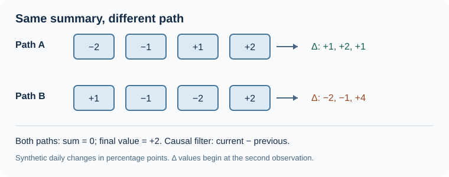

At 8:30, a scheduled report arrives. At 8:31, trading volume jumps. Reverse those two events and the same daily total tells a different story. A forecasting model that sees only the total cannot tell which happened first.

**Temporal deep learning is useful when the order and spacing of observations add predictive information beyond ordinary lagged features.** The test is whether that extra information improves forecasts on later dates, after its training cost and failure rate are counted.

*The order of observations can change the pattern a model sees even when the daily summary is identical.*

**Contents:** [Why use it?](#why-use-it) · [How it works](#how-it-works) · [The math](#the-math) · [Where OakQuant uses it](#where-oakquant-uses-it) · [Where it is used elsewhere](#where-it-is-used-elsewhere) · [Alternatives and tradeoffs](#alternatives-and-tradeoffs) · [People, libraries, and further reading](#people-libraries-and-further-reading)

## Why use it?

A lagged return, a rolling average, and yesterday's volume are cheap, strong starting points. They can still miss a pattern whose meaning depends on sequence: a gradual recovery and a sudden rebound can end at the same value. A causal sequence model reads only observations available by the forecast cutoff and learns filters or state updates that respond to those paths.

Use one when there is enough independent, dated history to test such patterns across later periods and when the forecast question needs them. If a linear lag model or a small tree gives the same held-out result, the larger network has earned no role. Adjacent 60-session examples share 59 sessions; treating them as 60 independent discoveries would exaggerate the evidence.

## How it works

Take two synthetic four-session paths of daily changes, in percentage points: **A** is −2, −1, +1, +2; **B** is +1, −1, −2, +2. Both sum to zero and end at +2. A two-position filter that computes current minus previous gives A the sequence **+1, +2, +1**, and B **−2, −1, +4**. The filter can detect a smooth recovery versus a late jump. These are teaching numbers, not observed market behavior; the sum of daily percentage returns is also not the compounded holding-period return.

For each forecast issue time, assemble an oldest-to-newest history of returns, volumes, and events, with a mask for missing observations. Attach static descriptors only when they were known then. A causal temporal convolution slides learned filters over the history; a recurrent model instead carries a state forward; attention can compare distant positions directly. A prediction head turns the resulting representation into a target such as a five-session return or the probability that return is positive.

The timestamp that matters is *availability*, not the date printed on a data row. A report describing an earlier period but released after the forecast cannot inform that forecast. A meeting date announced in advance may be a known future input; the meeting's decision cannot be. Temporal Fusion Transformers explicitly distinguish static traits, observed history, and known future inputs in their [original architecture](https://arxiv.org/html/1912.09363v3).

A suspected lead-lag signal needs a separate test. Fit a baseline using the target's own lags and relevant common drivers, then add the candidate series' earlier, actually available readings. Choose lags on training and validation periods; compare both models on the same untouched later dates. An improvement is predictive evidence, not proof that the candidate series caused the move. [Granger's original paper](https://doi.org/10.2307/1912791) formalized this distinction.

## The math

A gated recurrent unit (GRU) combines an old state with a proposed new one. With a convention in which the update gate weights the candidate,

$$
h_t=(1-z_t)h_{t-1}+z_t\tilde h_t, \qquad 0\le z_t\le1.
$$

Here $h_{t-1}$ is the prior state, $\tilde h_t$ the candidate state computed from the current input and gated history, $z_t$ the learned update gate, and $h_t$ the new state. The operations act element by element. If one old component is 0.2, its candidate is 0.8, and the gate is 0.25, the new component is $0.75(0.2)+0.25(0.8)=0.35$. The complete GRU also has a reset gate; this equation shows its final blend, not the whole cell. [Cho and colleagues](https://arxiv.org/abs/1406.1078) introduced the gated unit in a machine-translation model.

A causal convolution uses only the present and earlier positions:

$$
a_t=\phi\!\left(b+\sum_{j=0}^{K-1} W_j x_{t-jd}\right).
$$

Here $x_{t-jd}$ is an input vector $jd$ steps before $t$, $W_j$ its learned filter weight matrix, $K$ the filter width, $d$ the dilation or spacing between sampled positions, $b$ a bias, $\phi$ a nonlinearity, and $a_t$ the output at time $t$. At $K=2$ and $d=1$, weights $W_0=1$ and $W_1=-1$ produce the adjacent differences in the example above (with identity $\phi$ and zero bias). Larger dilation widens the view without reading a later position. [Bai, Kolter, and Koltun](https://arxiv.org/abs/1803.01271) tested causal convolutional networks against recurrent networks on sequence benchmarks.

## Where OakQuant uses it

In the current local Timber code, `timber/common/learning/temporal.py` (`TemporalModel`) supports a linear sequence baseline and a small trainable **causal temporal convolution** for offline experiments. It accepts oldest-first sequences, observation masks, and optional static descriptors, and fits scaling on the rows supplied for training. Its heads return a mean, expected absolute return, and probability of positive return. The latter is marked **uncalibrated**; expected absolute return is not volatility. The implementation has no known-future input channel. The caller must construct point-in-time histories and purge labels crossing the split boundary.

The `timber/common/learning/fleet.py` requirements registry marks GRU and TFT adapters unavailable. A shared panel model, richer event channels, and a possible TFT comparison remain design candidates in `docs/plan/ML_IMPLEMENTATION_PLAN.md`, conditional on dated data and locked chronological evaluation. The method describes market-data learning; it does not imply that private customer records train a shared market model.

## Where it is used elsewhere

The [Temporal Fusion Transformer study](https://arxiv.org/html/1912.09363v3) reports experiments on public multi-horizon forecasting datasets, including electricity demand, retail sales, and traffic. This documents a research evaluation, not a claim that a utility or retailer deployed the model. Its known-future inputs, such as calendar information, illustrate why an explicit availability boundary matters outside finance too.

## Alternatives and tradeoffs

| Approach | Useful when | What it gives up | Failure to watch |
|---|---|---|---|
| Linear model on explicit lags | Data are scarce; a transparent benchmark is needed | Learns limited nonlinear path interactions | Too many selected lags overfit the validation period |
| Boosted trees on lag and rolling features | Tabular predictors and moderate data dominate | Order must be encoded by chosen features | A summary erases a useful event sequence |
| Causal temporal convolution | Local or multi-scale ordered patterns have evidence | More training and less direct interpretation | Overlapping windows inflate apparent sample size |
| GRU | A learned running state is a useful inductive bias | Sequential computation is harder to parallelize | State captures release-time leakage |
| Attention or TFT | Long-range context and separate input types justify complexity | Greater data and compute demands | An unknown future value slips into a known-future channel |

Hold the issue dates, target, and scoring rule fixed across the comparison. Fit transformations and choose hyperparameters inside the training period; leave a later period untouched until selection is finished. An order-shuffling control can test whether the network actually uses timing. Also report training cost, failures, and whether gains survive changed market regimes. None of these architectures can repair a mislabeled cutoff.

## People, libraries, and further reading

**First stop:** [PyTorch's GRU documentation](https://docs.pytorch.org/docs/stable/generated/torch.nn.GRU.html) and [Conv1d documentation](https://docs.pytorch.org/docs/stable/generated/torch.nn.Conv1d.html) show the public building blocks. A library listing here is a learning resource, not an OakQuant dependency claim.

**Deeper reading:** [Kyunghyun Cho and coauthors](https://arxiv.org/abs/1406.1078) developed the GRU; [Shaojie Bai, J. Zico Kolter, and Vladlen Koltun](https://arxiv.org/abs/1803.01271) supplied an influential causal-convolution comparison; [Bryan Lim, Sercan Arık, Nicolas Loeff, and Tomas Pfister](https://arxiv.org/abs/1912.09363) introduced TFT for mixed-input, multi-horizon forecasting. [Clive Granger's paper](https://doi.org/10.2307/1912791) is the primary source for predictive lead-lag testing. None of these results establishes forecasting skill for OakQuant's data; that requires its own held-out comparison.
