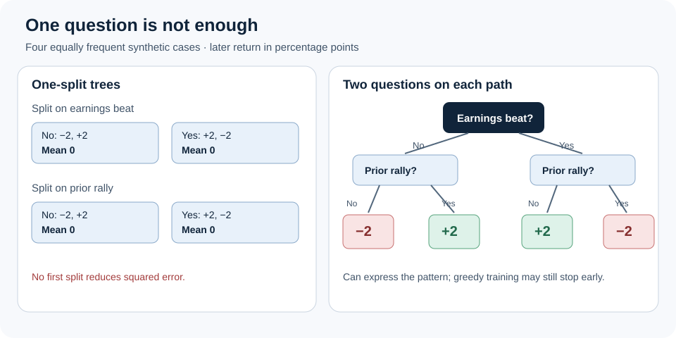

An earnings beat arrives before the market opens. One stock has climbed for weeks; another has fallen. The same headline may carry a different message for each. A forecast that gives the earnings beat one fixed weight cannot express that difference unless someone supplies an interaction term.

A decision tree offers another route: ask about the earlier price move, then interpret the earnings news within each group. That conditional logic is why trees are worth testing in financial forecasts. It is also where the details of the tree matter most.

*A tree needs both questions on a path to describe this invented interaction; a collection of one-split trees cannot recover it from these two inputs alone.*

**In brief:** Trees learn thresholds and conditional effects from examples. Their flexibility can capture patterns a plain additive model misses, but shallow trees have limits and deeper ones can memorize accidents.

**Contents:** [Why use it?](#why-use-it) · [How it works](#how-it-works) · [The math](#the-math) · [Where OakQuant uses it](#where-oakquant-uses-it) · [Where it is used elsewhere](#where-it-is-used-elsewhere) · [Alternatives and tradeoffs](#alternatives-and-tradeoffs) · [People, libraries, and further reading](#people-libraries-and-further-reading)

## Why use it?

Many financial inputs are conditional. A jump in trading volume after an earnings release is different from one on a quiet day. A debt ratio may matter more when borrowing costs rise. A tree can find a threshold, then ask a different question on either side. That lets it represent an interaction without writing every candidate pair into a regression formula.

This is a reason to **compare** trees, not a claim that they forecast returns well. If the relationship is approximately additive, a ridge regression can be simpler and more stable. If analysts can name a few plausible interactions in advance, adding those terms explicitly may be cheaper to fit and easier to audit. Tree complexity earns its place only through later, untouched observations.

## How it works

Start with dated examples. Each has inputs known at the forecast deadline and a return observed only after the chosen horizon. A regression tree searches for a question such as “was the prior return above this threshold?” It divides the training examples, repeats the search within each child group, and puts a prediction in each final group, or **leaf**. A new case follows the questions to one leaf.

Consider four equally frequent, synthetic cases. “Beat” means an earnings result above a declared expectation; “rally” means a prior price move above a declared threshold. The numbers are illustrative return targets in percentage points, not observations about real stocks.

| Earnings beat? | Prior rally? | Later return |
|---|---|---:|
| No | No | −2 |
| No | Yes | +2 |
| Yes | No | +2 |
| Yes | Yes | −2 |

A split on earnings alone leaves two groups averaging zero. So does a split on the prior rally alone. Yet a tree that asks both questions along each path can assign the four different returns exactly. The pattern is an interaction: changing one input reverses the effect of the other.

Standard tree growth has a limit. It is greedy: it chooses a first split for its immediate improvement. Here neither first split improves squared error, so a learner that requires positive gain may never grow the useful second level. The diagram shows **representational capacity**, not a guarantee that ordinary training will discover it. An explicit interaction feature, a search that looks ahead, or a different model can rescue the pattern. [XGBoost’s official tree tutorial](https://xgboost.readthedocs.io/en/stable/tutorials/model.html) also notes edge cases caused by split-by-split growth.

**Gradient boosting** builds a forecast in stages. It starts with a reference value and adds small trees that correct the current fit. Under squared error, those corrections follow residuals; another loss changes the direction of correction. A learning rate reduces each tree’s contribution. Jerome Friedman formalized the gradient-boosting view in [his 2001 paper](https://doi.org/10.1214/aos/1013203451). More trees do not fix every limitation: a sum of one-split trees still adds separate functions of individual inputs and cannot express the four-cell pattern above unless an interaction is supplied as an input.

Trees also stop at their learned leaves. Beyond the range of training inputs, they route a new value to an existing leaf rather than extending a slope. A split supported by three cases from one unusual week may encode that week, not a repeatable rule. Minimum leaf size, limits on depth and tree count, and validation on later dates all matter. Support should be checked across distinct dates and conditions, not just row counts.

## The math

For a boosted regression model, write the forecast after \(M\) trees as

$$
\hat y_M(x)=b+\eta\sum_{m=1}^{M}T_m(x).
$$

Here \(x\) is the input vector, \(b\) is the starting prediction, \(T_m(x)\) is the value reached in tree \(m\), \(M\) is the number of trees, and \(\eta\) is the learning rate. If \(b=1\) percentage point, two trees return \(+2\) and \(-1\) percentage points for a case, and \(\eta=0.1\), the forecast is \(1+0.1(2-1)=1.1\) percentage points. The example shows the arithmetic, not a fitted market result.

For uncertainty, a **quantile** is a conditional cutoff: a fitted 90th percentile aims to have outcomes at or below it in roughly nine of ten comparable cases. A quantile tree can fit that cutoff directly with **pinball loss**:

$$
L_{\alpha}(y,q)=
\begin{cases}
\alpha(y-q), & y\geq q,\\
(1-\alpha)(q-y), & y<q.
\end{cases}
$$

\(y\) is the realized return, \(q\) the predicted cutoff, and \(\alpha\) the desired quantile level. At \(\alpha=0.9\), a cutoff of \(2\) percentage points and an outcome of \(4\) costs \(0.9(4-2)=1.8\) percentage points of loss; an outcome of \(0\) costs \(0.1(2-0)=0.2\). The unequal penalties push the fitted cutoff toward the chosen quantile. [Scikit-learn’s official documentation](https://scikit-learn.org/stable/modules/generated/sklearn.ensemble.HistGradientBoostingRegressor.html) identifies this loss in its quantile boosting implementation.

Separate quantile fits may cross, with a nominal lower cutoff above an upper one. They need an ordering rule and held-out coverage checks. A few cutoffs do **not** define a full return distribution: probability between and beyond them remains unspecified. NGBoost takes a different route by fitting parameters of a chosen distribution, but the chosen family may miss the tails. [Duan and colleagues’ paper](https://proceedings.mlr.press/v119/duan20a.html) describes that approach.

## Where OakQuant uses it

The current **Timber** package implements bounded, batch, squared-error boosting with regression **stumps**—trees with one split. Its fit_boosted_stumps routine accepts optional sample weights, fits residual corrections, and returns point predictions. It does not fit depth-two interactions or quantile cutoffs. The investment-domain candidate builder imports that routine as a gradient_boost family; the domain adapter is responsible for making inputs eligible at the forecast deadline. Source: timber/common/learning/boost.py and oak-domain-investments/oak_domain_investments/adapt/competition_models.py in the current local checkout. This is implementation evidence, not proof of a deployed or successful trading forecast.

The [current ML implementation plan](../../../../ML_IMPLEMENTATION_PLAN.md) proposes comparing explicit interactions and bounded depth-two trees, then direct quantile boosting and distributional challengers such as NGBoost. Those are proposed experiments, not capabilities of the Timber stump learner. The plan’s preserved synthetic probe found that its stumps missed a pure cross-feature interaction; that test says nothing about market skill.

For a fair comparison, OakQuant would train each candidate only on information available before each issue time, choose depth and other settings on earlier validation dates, and compare matched forecasts after outcomes settle. Shifting a filing to after the issue deadline should remove it from the inputs. A missing feed should be masked to test whether the apparent split depends on a vendor outage. User portfolio records are not training examples for a shared market model.

## Where it is used elsewhere

Shihao Gu, Bryan Kelly, and Dacheng Xiu compared machine-learning methods for **monthly stock risk-premium prediction** using a long historical U.S. equity panel. Their published study reports gains from tree and neural-network methods and traces much of the benefit to nonlinear predictor interactions. That is evidence that interactions mattered in **their** research setting; it does not establish skill for OakQuant’s horizons, inputs, or deployment. [Read the published study](https://doi.org/10.1093/rfs/hhaa009).

## Alternatives and tradeoffs

| Approach | Useful when | What it gives up; failure to watch |
|---|---|---|
| Ridge regression | Effects are roughly additive, data is limited, or a strong baseline is needed | Fixed linear effects miss thresholds and interactions unless features are supplied. |
| Ridge plus named interactions | A few conditional relationships have a clear rationale | The analyst must choose pairs; many speculative pairs can overfit. |
| Boosted stumps | Separate nonlinear effects are plausible and a bounded model is enough | No cross-feature interaction from raw inputs alone; greedy fitting can miss a pure interaction. |
| Deeper boosted trees | Conditional paths are plausible and there is enough dated evidence | More capacity to memorize rare episodes; poor extrapolation beyond training ranges. |
| Quantile boosting or NGBoost | A tail cutoff or fitted distribution is needed | Quantiles may cross or leave gaps; a distribution family can misstate tails. Check calibration on later dates. |

## People, libraries, and further reading

Leo Breiman, Jerome Friedman, Richard Olshen, and Charles Stone developed the CART framework in [*Classification and Regression Trees*](https://www.routledge.com/Classification-and-Regression-Trees/Breiman-Friedman-Stone-Olshen/p/book/9780412048418/). Friedman’s [gradient-boosting paper](https://doi.org/10.1214/aos/1013203451) is the deeper source for stagewise fitting. For probabilistic boosting, start with [Duan and colleagues’ NGBoost paper](https://proceedings.mlr.press/v119/duan20a.html).

For a practical first stop, [scikit-learn’s histogram gradient-boosting regressor](https://scikit-learn.org/stable/modules/generated/sklearn.ensemble.HistGradientBoostingRegressor.html) documents depth controls, missing-value handling, and quantile loss. [XGBoost’s tree tutorial](https://xgboost.readthedocs.io/en/stable/tutorials/model.html) explains additive training and split gain. [LightGBM’s parameter reference](https://lightgbm.readthedocs.io/en/stable/Parameters.html) documents its quantile objective. These are public learning tools, not a list of packages used by OakQuant.
