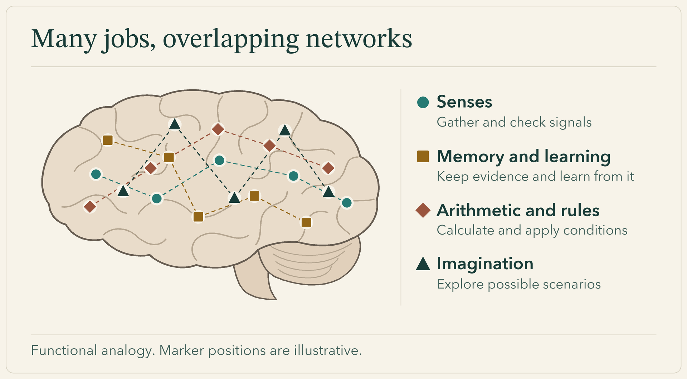
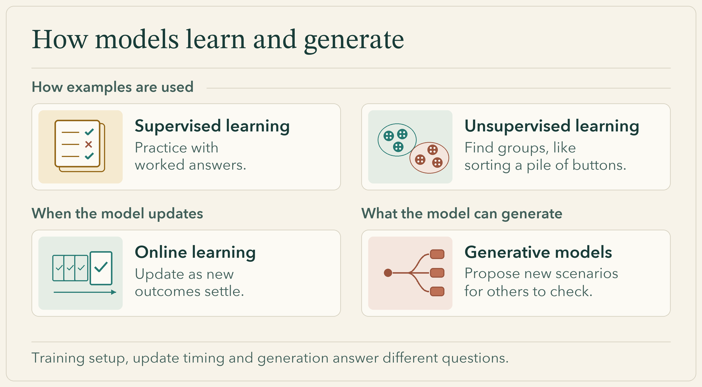
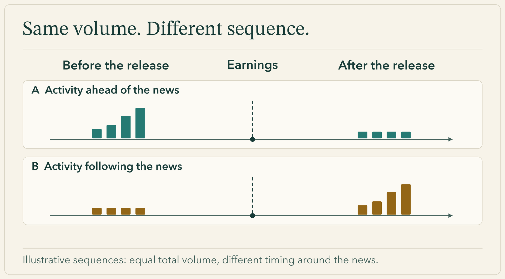
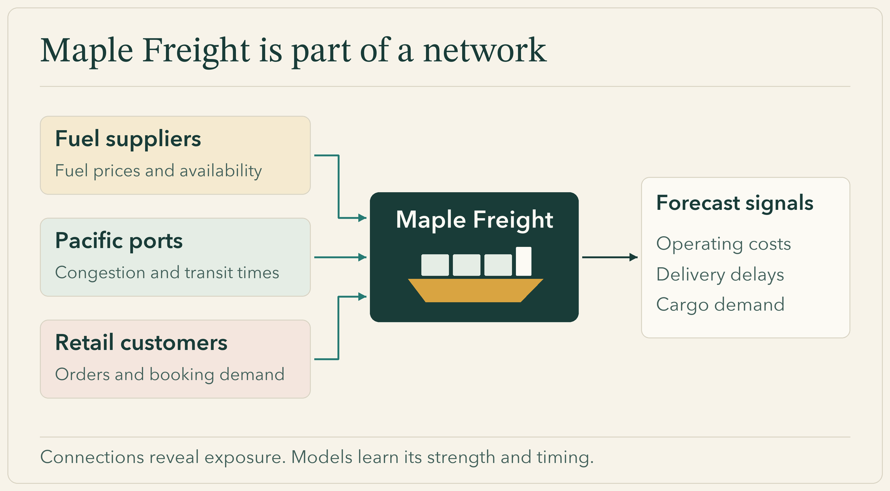
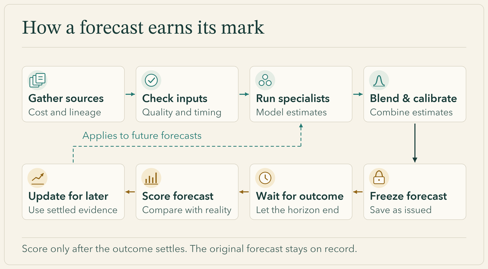
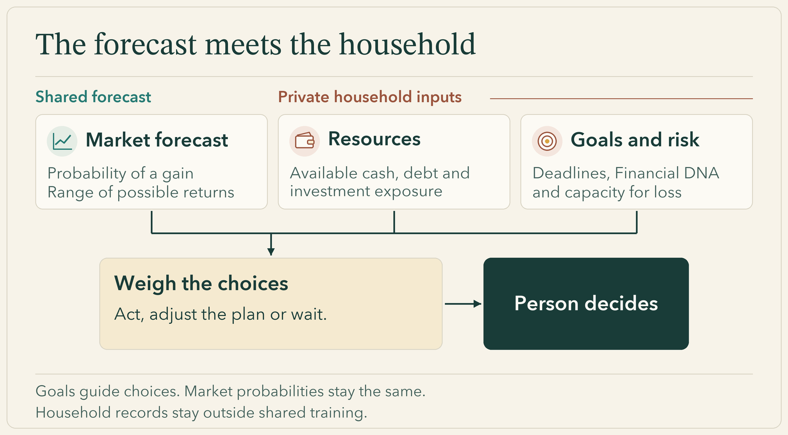

*Every serious forecast begins with a defined target, a fixed deadline, and a record that cannot be edited after the fact.*

Five-year-old Maleena comes down to breakfast in her yellow rain boots. Through the kitchen window, she has spotted a gleaming puddle on the garden path. To a five-year-old, the chain of logic is effortless: there is water on the stones, which means it rained overnight, which means there are puddles waiting to be jumped in.

Then her father opens the back door and points to the neighbor’s garden hose, which has been left trickling across the concrete beneath a cloudless sky. The puddle is real, and Maleena steps into it anyway. But as a piece of evidence about the weather, it is a trap.

Over supper that evening, a bigger question comes up. Her aunt and cousins are visiting for a picnic in two Saturdays, and Maleena wants to know whether they will be able to spread their blanket on the grass beside the swings or whether they will be forced under the park shelter. When her father tells her it is too early to say, she pulls a wooden stool up to the kitchen calendar. Until the picnic, she’ll practice by forecasting one day at a time. Every morning for the next two weeks, she will draw a guess on the left side of the square. Every evening at supper, they will record what actually happened on the right.

The calendar enforces a distinction that memory easily blurs: what she thought before the rain, and what she knew afterward. What Maleena is building at the kitchen table is what a forecasting engine has to build at scale. In financial AI, a persuasive explanation of a past price move can conceal a poor forecast, an impressive historical backtest can depend on data that was unavailable at the time, and relationships that once predicted returns can fade as markets shift.

To learn honestly from experience, OakQuant divides the work the way a brain does. Neuroimaging studies of [mathematical reasoning](https://pmc.ncbi.nlm.nih.gov/articles/PMC4983814/), [holding task rules in mind](https://pmc.ncbi.nlm.nih.gov/articles/PMC2705703/), and [creative idea generation](https://pmc.ncbi.nlm.nih.gov/articles/PMC4472024/) show distinct neural networks cooperating on different kinds of thought. In software, we likewise give data hygiene, calculation, statistical learning, and creative exploration distinct responsibilities—and we can trace how they connect by following Maleena’s calendar alongside a fictional container-shipping line, **Maple Freight**. Throughout, three questions govern the system: what should we believe, how strongly should we believe it, and what should we do with that belief?

*In human brains and in OakQuant, distinct networks cooperate on a single problem—though in software, those jobs live in code rather than anatomy.*

## 1. The contract on the card

When Maleena uncaps her marker on day one and draws a cloud on the calendar, her father asks a question that sounds pedantic but changes everything: if a brief shower passes over the house at two in the morning while everyone is asleep, does her cloud win? 

Maleena thinks about her picnic blanket. Midnight rain at home is beside the point; she cares about daytime hours between breakfast and supper, and eventually she cares about the park down the road. They agree on the rules before the first day begins. On her first five mornings, she draws a cloud every day, getting one right out of five: four times her father draws a bright sun beside her mark, until an afternoon shower finally arrives on day five. "That one’s mine," she says, tapping the lone match.

In financial forecasting, vague questions produce unverifiable answers. If an investor asks whether Maple Freight—a mid-sized carrier moving containers across the Pacific—will "do well this week," a model cannot learn until the terms of the contract are fixed. In OakQuant, "this week" is translated into a precise horizon—say, five trading sessions from today’s market close, automatically accounting for any exchange holidays that push the fifth session further out on the calendar. The target metric is locked down just as tightly: are we predicting closing prices adjusted for stock splits, or total return including a quarterly dividend Maple Freight is scheduled to distribute on Thursday?

Even more important is defining what constitutes success. Suppose that over those five sessions, the broader equity market rises 2%, the maritime shipping sector climbs 3%, and Maple Freight gains 1%. In absolute terms, the stock went up. Relative to its shipping peers, it lagged by two full percentage points. A shift in central bank interest rates might explain the broad market lift; a surge in container spot rates might explain the sector rally; a cautious earnings call might explain why Maple trailed the fleet. By separating absolute return from sector and market benchmarks at the outset, the system knows exactly which puzzle it is trying to solve.

## 2. Gathering clean evidence

Before any model can answer the question about Maple Freight, the engine must establish what its evidence means. Models live on **features**—signals extracted from exchange ticks, trading volumes, regulatory filings, macroeconomic releases, and news wires. A price rise caused by a change in how a vendor adjusts its records tells a different story from a price rise caused by investors buying shares. Passing both to a model as the same observation teaches it the wrong lesson.

Maleena's garden puddle captures this problem well: the observation was accurate, but the explanation was wrong. She takes a small step toward better evidence when she puts a measuring cup outside, beyond the porch roof and the gutter's drip line, where it can catch rain directly.

In OakQuant, a shared data layer called **Timber** checks incoming market feeds and keeps each value connected to its source. A closing price carries its trading date, currency and split-adjustment state. An earnings figure carries both the fiscal quarter it measures and the exact minute it crossed the wire. When five financial portals republish the same Reuters dispatch, the data layer traces the syndication links back to the root source and counts a single event rather than an artificial burst of five.

Getting that evidence also carries a real financial cost. Before pulling an external feed, the system checks whether a stored snapshot already meets the task's needs. Several models can reuse it if its coverage, freshness and licensing allow that use. When something is missing, the choice of provider depends on the required fields, historical versions, adjustment conventions and delivery time, as well as price. A cheap feed that needs repeated repairs may cost more overall. The aim is to pay for information that improves the answer and reuse information that remains fit for the job.

A routing layer called **Cambium** applies the same discipline to computation, deciding which tool should handle a task. When the system calculates the value of a holding, it routes the multiplication of shares and price to deterministic arithmetic. When it needs to check whether a historical indicator carries weight, it runs fast statistical routines. It reserves heavy generative models strictly for tasks that require language synthesis, scenario framing, or open-ended hypothesis generation—and even then, every claim is checked against the verified data ledger.

## 3. Point-in-time memory

In quantitative research, look-ahead bias can quietly ruin a promising model. It happens whenever a system accidentally uses tomorrow’s knowledge to simulate yesterday’s decision. A shipping company like Maple Freight might close its first fiscal quarter in March, release its preliminary earnings in May, and file a restated figure in July. Government agencies routinely revise GDP and freight indices months after the initial print. If an engineer trains a model to replay an April forecast using a database that silently overwrites old numbers with July’s revisions, the backtest will look miraculous—and the live model will fail the moment it faces the real world.

Early the following week, Maleena rushes off to preschool and forgets to draw her morning symbol. When she returns at four o’clock, her sneakers are soaked from an afternoon downpour. She grabs her marker and reaches for the empty morning slot on the calendar to draw a cloud. Her father reminds her that the morning slot is for a guess made before the day unfolds. You cannot predict a storm you have already walked through. The morning square stays blank.

To prevent time-travel leaks, OakQuant enforces strict **point-in-time accounting**, modeled on archival standards like the [Federal Reserve Bank of St. Louis’s ALFRED database](https://fred.stlouisfed.org/docs/api/fred/realtime_period.html). Every record carries three distinct clocks: the period the data describes, the moment that specific version was released to the public, and the timestamp when our servers received it. 

When we replay an April forecast for Maple Freight, the engine seals off everything recorded after that exact instant. Just as crucially, it distinguishes between three states that careless databases lump together as zeros or blanks: a company that genuinely earned zero dollars, a report that has not yet been published, and a vendor feed that went offline. By preserving the exact texture of what was known and unknown at the time—and keeping shared market training records strictly isolated from any user’s private portfolio data—every experiment can be replayed without cheating.

## 4. Following Maple Freight through the models

By day ten, the outcome side of Maleena's calendar shows seven dry days and three rainy ones. That settled tally gives her a starting point before she looks for other clues. It also illustrates a **baseline**: a simple reference rate that any more elaborate method has to beat.

*Learning from labeled outcomes, finding groups, updating over time and generating ideas describe different aspects of a system. A model can combine several of them.*

To see what it takes to improve on a baseline in finance, let's leave Maleena at her calendar and step into Maple Freight's third-quarter earnings release. Before the market opens, the carrier reports higher quarterly profits, yet its executives warn on the conference call that bunker-fuel bills are climbing and two Pacific ports are backing up. By the closing bell, Maple's shares have jumped on heavy volume alongside other shipping stocks. At that day’s close, to estimate where the stock will trade over the next five sessions, the engine examines the company through three complementary lenses, each explored in our companion series.

**Weighing history and peers.** The engine begins with a linear model that assigns weights to direct clues such as recent returns, fuel costs, and earnings surprises. With many overlapping signals, a model can fit historical quirks too closely; ridge regression penalizes extreme weights to resist overfitting, while adaptive gradient methods adjust the learning steps using earlier gradients. Still, if Maple Freight has a short listed history, its own record may not show how its shares behave when fuel prices spike. A Bayesian hierarchy addresses this by partial pooling—drawing on related carriers, the broader industrial sector, and the market as a whole to give the estimate a wider foundation, then shifting weight toward Maple’s own behavior as its track record grows, while carrying uncertainty through every level.

**Reading context and timing.** The meaning of a clue also depends on what happens alongside it. Unusual trading volume after an earnings release carries different information from unusual volume on a quiet Tuesday with no company news. Decision trees learn these conditional relationships by asking successive questions, while gradient boosting builds a sequence of trees, each adding a correction to the combined prediction so far. Because market relationships shift between periods of easy credit and funding squeezes, clustering algorithms group similar weeks into regimes without requiring pre-set labels—identifying peers outside formal industry codes or flagging models whose mistakes tend to arrive together.

A temporal neural network reads the exact chronological order of trading, distinguishing a burst of volume *before* Maple's announcement from a burst *after* it.

*The same total activity can tell different stories. A temporal model retains the order that an aggregate would hide.*

**Mapping the outside world.** Finally, much of Maple's exposure sits outside its own trading history: it depends on ports, fuel suppliers, and retail customers whose disruptions ripple across the fleet. A graph model maps those commercial links directly.

*A company’s forecast draws on the businesses and infrastructure it depends on. The connections identify exposures; their effects are learned from evidence.*

An energy-based model scores which combinations of signals—such as shifting freight rates, fuel costs, and volatility—fit the joint patterns learned from historical data.

Maple’s history and its peers give the forecast a starting point. Market conditions and the order of events help us judge what today’s news adds. Ports, suppliers, and customers show where other changes might reach the company. How much weight each model gets depends on how well it has forecast comparable cases.

## 5. The biscuit tin: Ensembles, calibration, and honest scoring

Back at the kitchen calendar, a few days before the picnic, Maleena’s cousin joins her in making morning guesses—and quickly reveals why combining forecasts is harder than it looks. She watches the clouds and he watches the wind. One morning they both predict rain after seeing their aunt take towels off the clothesline. She was simply bringing in dry washing. By supper, the day has stayed dry and both children have the same miss to record.

Different forecasters can share a blind spot. OakQuant weighs each model using settled, out-of-sample results for the type of question at hand. Evidence that a model helps with five-day shipping forecasts earns it influence on Maple Freight. That influence does not automatically transfer to a twenty-day banking forecast. When an industry's record is sparse, the engine draws on broader evidence and records where that support comes from.

The blend also preserves what the models disagree about. One may place most of its probability on small gains while another assigns more probability to a large loss. A **weighted mixture** combines their full distributions in the chosen proportions. From that combined distribution, the engine obtains the chance of a gain, the expected return and a range of possible outcomes. These are connected descriptions of the same forecast.

By Friday, Maleena has also realized that *how much* it rains is a different question from *how sure* she is that rain will fall. On her calendar key, one raindrop stands for a light sprinkle and three stand for puddle-making rain. On Saturday morning, she looks up at a bruised gray sky and tells her father she expects a light rain at the park before lunch—one drop on her key, not a three-drop downpour.

"How sure are you?" he asks.

"A little more than half," she says. "The clouds look like the day it poured. But yesterday was windy too, and it stayed dry."

Her father writes down her complete forecast on an index card—*One-drop rain at the park before noon; a little more than half sure*—stamps the morning time at the top, and watches her drop the folded card into a metal biscuit tin. If the sky clears at eleven o’clock, she is welcome to write a second card. But the morning card stays sealed in the tin.

OakQuant treats every forecast it issues like a card in that tin. A 60% probability of a five-day gain for Maple Freight describes the chance of that event. Historical accuracy describes how often the model's calls have been right. The distinction matters: [Guo et al. (2017)](https://proceedings.mlr.press/v70/guo17a.html) showed that neural networks could achieve strong accuracy in image and document classification while assigning poor probabilities.

**Calibration** checks whether events assigned a 60% chance occur about six times in ten across many comparable forecasts. Overlapping dates and stocks that move together share evidence, so the evaluation accounts for that dependence. It also compares each model with a baseline on the same cases. Calibration tells us whether the probabilities deserve trust. Comparison with the baseline tells us whether the added machinery earns its place.

When a forecast goes out, the system freezes the question, the data versions, the individual model distributions and the mixture weights. After the fifth trading session closes, [proper scoring rules](https://sites.stat.washington.edu/people/raftery/Research/PDF/Gneiting2007jasa.pdf) evaluate the forecast. These rules reward honest probabilities in expectation across outcomes. The resulting evidence changes how much influence a model receives on future questions, while the original forecast remains intact.

This is how adaptation becomes part of the engine's daily work. If a specialist repeatedly loses its advantage during shipping earnings weeks, its influence can fall in that context. Another may earn more weight by adding information the others miss. Larger refits revisit the underlying models as market relationships change. Every part of the process has a record against which its contribution can be judged.

*Every published forecast is sealed with its point-in-time inputs and scored only after the real-world outcome settles.*

## 6. When the brain meets the body

At the park, Maleena's family chooses a table under the shelter. It costs them little to sit there, and rain would spoil lunch on the open grass. Five minutes before noon, a light drizzle begins—just enough to wet the flagstones outside the roof. When Maleena opens the tin, her father reads back what she predicted that morning: one drop of rain, a little more than half sure. They have another result for the calendar, and a dry place to eat.

Her family has used the forecast to make a decision, bringing something to it that the weather alone cannot supply: what matters to them and what each choice would cost. We can now bring Maple Freight back into the same question.

Suppose two households see the same forecast for the stock: a 60% chance of a five-day gain, with the same forecast also describing the likelihood and size of losses. The first household already holds several shipping stocks and needs money for tuition in three weeks. It cannot put that payment at risk by tying up more of its available cash. The second has no shipping exposure, keeps a cash reserve and is investing toward a goal many years away. For that household, the five-day forecast informs the immediate decision; longer-horizon forecasts and the financial plan determine whether the investment serves the goal.

The second household has more room to consider the opportunity. Its goals and existing investments still determine whether Maple belongs in the portfolio and how much exposure makes sense. The first household's immediate priority is protecting the tuition money. One market forecast leads to different choices because it meets different needs.

In our architecture, the household’s financial position—its assets, liabilities, income streams, and dated obligations—is the **body**. OakQuant connects the brain to the body through **Financial DNA**, an explicit profile that separates a person’s psychological *willingness* to stomach volatility from their structural *capacity* to absorb a loss. Shared market training uses approved market data, including licensed sources. Private household records have a separate purpose and permission boundary. Combining calibrated market probabilities with a household’s resources and goals turns a forecast into a decision suited to that household.

*Two households looking at the same market forecast face different decisions depending on their cash buffers, liabilities, and timeline.*

Back in the kitchen that evening, Maleena pins her card to the calendar and draws a single raindrop beside her morning estimate. When her father asks about tomorrow, she pulls her stool over to the window to look.

---

## Companion articles in this series

*Maleena and Maple Freight are fictional illustrations used to explain OakQuant’s system architecture. Explore the technical deep dives for each component below:*

- [Giving the brain good senses](https://press.oakquant.ai/public/articles/brain-data-and-cost) — Data provenance, deduplication, and cost-aware routing with Timber and Cambium.
- [Point-in-time memory](https://press.oakquant.ai/public/articles/brain-point-in-time-memory) — Vintages, as-of joins, and tests that respect what was known at each cutoff.
- [Baselines and adaptive gradients](https://press.oakquant.ai/public/articles/brain-baselines-and-adaptive-gradients) — Establishing naive yardsticks, regularization, and gradient-based fitting.
- [Bayesian hierarchies](https://press.oakquant.ai/public/articles/brain-bayesian-hierarchies) — Partial pooling and propagating uncertainty across market, sector, and company levels.
- [Trees and interactions](https://press.oakquant.ai/public/articles/brain-trees-and-interactions) — Conditional feature interactions and gradient-boosted decision trees.
- [Clustering and regimes](https://press.oakquant.ai/public/articles/brain-clustering-and-regimes) — Identifying volatility regimes, peer groups, and correlated model errors.
- [Temporal deep learning](https://press.oakquant.ai/public/articles/brain-temporal-deep-learning) — Capturing event sequences and lead-lag relationships in time-series data.
- [Energy and relationships](https://press.oakquant.ai/public/articles/brain-energy-and-relationships) — Graph networks and energy-based models for supply-chain and cross-asset links.
- [Combining and calibrating](https://press.oakquant.ai/public/articles/brain-combining-and-calibrating) — Predictive mixtures, performance weighting, and probability calibration.
- [Learning from outcomes](https://press.oakquant.ai/public/articles/brain-learning-from-outcomes) — Proper scoring rules, delayed settlement, and handling concept drift.
- [The rules engine](https://press.oakquant.ai/public/articles/brain-rules-engine) — Deterministic guardrails, fallback logic, and auditable decision logs.
- [Generative capability](https://press.oakquant.ai/public/articles/brain-generative-capability) — Hypothesis generation, scenario framing, and grounded plain-language synthesis.