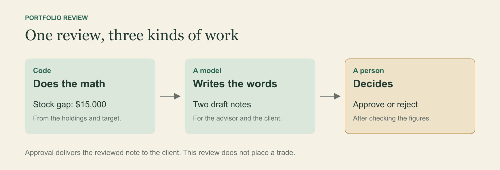

You buy nothing. You sell nothing. A year passes, and your portfolio holds a different mix from the one you chose.

Some investments grew faster than others. Your decision stayed where you left it. Your money moved.

Here is a simplified example. An investor's target puts 60 percent of the portfolio in stocks, 30 percent in bonds, and 10 percent in cash. Later, the portfolio is worth $100,000 and has this mix:

| Asset class | Target share | Current share | Current value |
|---|---:|---:|---:|
| Stocks | 60 percent | 75 percent | $75,000 |
| Bonds | 30 percent | 15 percent | $15,000 |
| Cash | 10 percent | 10 percent | $10,000 |

The stock share is now 15 percentage points above its target. The owner has made no new decision to hold that much stock.

That gap is called portfolio drift. Follow the $15,000 difference through a review and you can see how a number becomes something an advisor can act on.

In OakQuant, the financial research and planning platform I built, the portfolio-review process separates the calculation, the explanation, and the decision. Following one review makes the separation easier to see.

## The calculation is already settled

At a current value of $100,000, the target stock amount in our example is $60,000. The portfolio holds $75,000 in stocks. The difference is $15,000.

The target bond amount is $30,000, and the portfolio holds $15,000. That leaves a matching shortfall. Cash is already at its target.

The calculation gives the advisor a concrete starting point: $15,000 to move between asset classes if the original target still fits the client.

OakQuant's review service compares the current asset mix with a target from its Financial DNA assessment. Its default trigger is a difference of more than 10 percentage points in any asset class. Eligible accounts that cross that threshold can be routed for review.

The service calculates the suggested changes by asset class and passes the current mix and target to the writer. The $15,000 difference now has a second job: giving the explanation its starting point.

## The model gets a writing assignment

An advisor and a client may need to understand the same review in different ways.

For the advisor, the note needs to explain the gap and the proposed changes clearly enough to check against the holdings and the target. The client needs context. How did the mix change while they were leaving it alone?

OakQuant gives the model a small summary and asks it to draft those two notes. The supplied numbers constrain what the notes should say.

For our example, a client explanation might read:

> Stocks now make up 75 percent of your portfolio, compared with your target of 60 percent. The review shows the changes needed to return to that target. Your advisor will check whether those changes fit your circumstances.

That illustrative note connects the figures to something the client experienced: leaving the portfolio alone while its mix changed. The advisor gets a draft to work with. The client gets an explanation of why a review appeared.

If the model service fails, a fixed template can assemble the notes from the same figures so the review can still reach the advisor. An outage need not add another unfinished job to the queue.

## The job has somewhere to wait

The figures and notes are ready. The advisor is not. They may be in a meeting or waiting to speak with the client, and the review needs somewhere to wait until they can give it their attention.

OakQuant creates an assignment in an advisor queue. The review has a record that can be claimed, inspected, and resolved. The advisor can edit the notes and approve or reject the review. Approval delivers the reviewed material to the client.

This is where a working product asks more of you than a demonstration. In a demonstration, the answer appears while everyone watches. In a product, somebody closes the laptop and comes back later expecting the unfinished work to be there.

When the advisor returns, the figures and draft are attached to the assignment. They can pick up the review where they left it. Nobody needs to reconstruct the case from a chat history.

## Follow the case through the software

Grove is OakQuant's workflow engine. It reads a definition of the steps in a job and the conditions for moving between them.

For this review, the preparation workflow detects drift, drafts the notes, creates the assignment, and saves the result. The advisor then works on that assignment through the review service.

By the time the assignment reaches the queue, Grove has finished preparing the review and saved the $15,000 difference with the draft notes. The review service now holds the case for the advisor to claim and inspect.

The advisor can continue from that record without asking the model to calculate or explain the same portfolio again. Preparation is complete. The decision remains open.

## Give the human enough to disagree

Now suppose the advisor opens our example and learns that the client expects a large cash expense. The original target deserves another look. Moving $15,000 into bonds may no longer fit.

The subtraction still works. The recommendation needs judgment.

OakQuant lets the advisor inspect the review, edit its notes, and approve or reject it. That matters here because the advisor has learned something the original figures could not tell them.

This is also the point to check the draft against the numbers and consider taxes, fees, and the client's circumstances. A model can copy a figure incorrectly or omit a condition. The reviewer needs the source figures within reach.

Approval delivers the reviewed material to the client. It does not place trades. The record preserves what was decided, and execution of any investment change remains a separate event.

At the start, the investor had a portfolio that had moved away from its target. By the end, the advisor has a case to resolve and a client explanation to edit, with the arithmetic already done.

The person can spend their attention on why the target still fits, or why it should change. That is the payoff I want from the software around the model.

This week, choose one process that needs someone to sign it off. Mark the steps that calculate, explain, and require a decision, then check whether the reviewer receives the evidence needed to disagree with the suggested result. Try rejecting it. Check what the system saves.

This is the second of four articles about building OakQuant. The next considers an agent that can discover the available tools and propose how to use them.

Explore OakQuant at [sky.oakquant.ai](https://sky.oakquant.ai/), or use the [advisor inbox](https://sky.oakquant.ai/advisor) to inspect and resolve portfolio reviews if you have eligible enterprise access as an advisor.

The portfolio figures are illustrative. OakQuant is for research and education. A target allocation and the arithmetic to reach it do not establish suitability for an individual investor.
