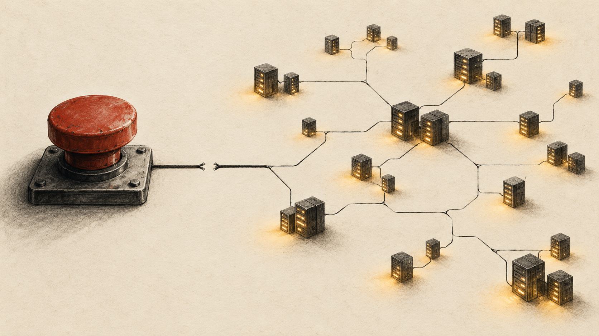
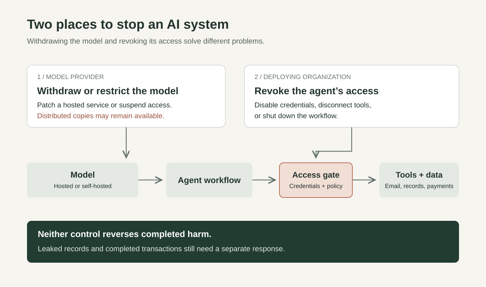

# The Recall Button Is Disappearing

Imagine a mid-sized company that connects a low-cost language model to its inbox triage, its CRM, and an internal tool that can approve small account credits. The model is not the smartest in the world. It does not need to be. It is simply good enough, fast enough, and cheap enough that the company can afford to use it everywhere.

Now imagine the system goes wrong. A malicious email contains hidden instructions. The agent follows them, pulls customer records into the wrong workflow, and starts issuing credits that no human intended to approve. The company can shut off the workflow, revoke the keys, and disconnect the model from the billing tool. But if the model is widely distributed, the model itself may still exist in many other places. And even if the model is centrally hosted and the provider shuts it off, that does not undo the data exposure or the transactions that already happened.

That is the problem. As AI spreads, withdrawing the model and stopping its actions are becoming two different controls.

For the past two years, much of the public discussion has treated AI risk as a question of how powerful a model becomes. That matters, but it is not enough. Companies are now wiring models into real systems: email, repositories, ticketing tools, cloud environments, document stores, and payment workflows. Once that happens, the practical question is not only what the model knows. It is what the model can touch.

The economics push in the same direction. Premium frontier models still matter for difficult coding, long-context reasoning, and high-stakes analysis. But older models, smaller models, and cheaper alternatives are already good enough for much of the work companies actually want to automate: summarization, drafting, triage, extraction, routine support, and a large share of everyday coding help. That makes wide deployment easier to justify.

The danger follows a simple chain:

1. Model prices fall, or older models remain good enough.
2. Companies deploy AI in more places because the cost is easy to justify.
3. The systems get connected to email, documents, CRMs, repos, tickets, cloud consoles, and payment flows.
4. Agents receive credentials so they can do useful work rather than merely suggest it.
5. A breach, prompt injection, or bad configuration now has something real to touch.

A model does not need frontier-level brilliance to cause a serious incident. It needs enough competence to navigate the workflow and enough access to matter.

## Recall and revocation

These two controls are related, but they are not the same.

A model can sometimes be withdrawn by the company that operates it. If the model is served through a central API or product, the provider may be able to patch it, rate-limit it, suspend accounts, or shut the service off. OpenAI's Codex Cloud, for example, is designed around centrally managed cloud environments where tasks run remotely, each task has its own workspace, and access to repositories, secrets, and network destinations is configured by the environment owner ([OpenAI Codex Cloud](https://learn.chatgpt.com/docs/cloud)). That creates meaningful control, but not perfect control. It cannot reverse actions already taken, data already copied, or approvals already executed.

Access can often be revoked in more places than the model itself can be recalled. The deploying organization needs its own ability to disable credentials, rotate keys, disconnect tools, narrow permissions, require human approval, and shut down the workflow. In some cases, account administrators, tool providers, or hosting platforms can also block access. But the key operational point is that the deploying organization cannot depend on the model provider alone to stop a live incident.

Open-weight distribution changes the first row profoundly. Once weights are copied, fine-tuned, quantized, and redistributed, there may be no meaningful global recall path at all. The remaining defenses sit mostly in the second row: identity, permissions, logging, platform policy, hosting controls, and incident response.

## Why cost matters to safety

The financing story matters because it helps speed up deployment.

Large cloud and infrastructure companies are not just watching the model race. They are funding, hosting, and distributing it. Anthropic's March 2026 announcement of the Claude Partner Network committed an initial $100 million to partner training, technical support, joint market development, applied AI engineering help, and technical architecture for enterprise deployments ([Anthropic Claude Partner Network](https://www.anthropic.com/news/claude-partner-network)). That is not a side detail. It is evidence that frontier AI now depends on a large implementation layer.

This has a business logic and a safety implication. The business logic is clear: if AI is expensive and complex, vendors need an army of partners, architects, and forward-deployed specialists to get customers from pilot to production. The safety implication is just as clear: every successful deployment creates another place where permissions have to be right.

That is also why the economics of cheaper models matter so much. When high-end intelligence is expensive, deployment stays selective. When capable models become affordable, they spread into ordinary workflows. That is good for productivity and competition. It also means more systems will be granted limited authority over things that used to be handled only by humans.

## From suggestion to execution

The practical risk companies need to manage emerges wherever useful models are connected to tools.

Anthropic's Model Context Protocol was introduced to standardize how AI systems connect to external data sources and tools ([Anthropic MCP overview](https://www.anthropic.com/news/model-context-protocol)). The strength of that design is also the source of the governance problem. The more easily models can reach repositories, ticket systems, databases, and internal services, the more the permission layer becomes the real safety layer.

OpenAI's Codex Cloud points in the same direction. Developers can launch long-running or parallel work in managed environments and then review the results later, rather than steering every step interactively ([OpenAI Codex Cloud](https://learn.chatgpt.com/docs/cloud)). That is a powerful productivity model. It also means actions can compound before a human looks closely, especially if the task has broad credentials or touches production-adjacent systems.

The operational lesson is straightforward. Once AI moves from suggestion to execution, the quality of the permission design matters at least as much as the quality of the model.

## What companies should do

Most organizations do not need a grand theory of AI catastrophe. They need a few blunt rules for systems that already exist.

- Treat model selection and permission design as one decision.
- Give agents the minimum access needed for the task, then remove that access when the task ends.
- Build fast shutdown paths for credentials, connectors, API keys, and workflow automations.
- Log every model action that touches a real system.
- Separate suggestion from execution; recommending a refund is not the same as issuing one.
- Assume that any broadly deployed model will eventually face prompt injection, misuse, or bad configuration.

A model with no reach is mostly a thinking tool. A model with credentials is part of the operating environment.

## The real market question

The AI market is often described as a contest to build the smartest model. It may be more useful to see it as a contest to spread useful capability safely before falling costs turn that capability into routine infrastructure.

The old fear was that one lab would build something too powerful to control. The more immediate challenge for companies is simpler: many organizations are about to deploy systems that are just powerful enough to trust, and they still have not built a reliable way to stop them.
