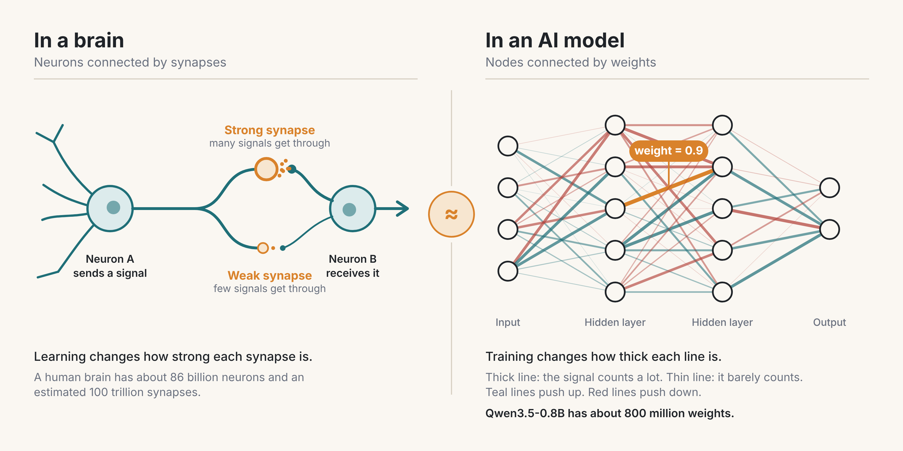

One dot in about six thousand stands for the share of weights Astra changed. It is not one literal weight.

On November 2, 2026, four researchers at the Massachusetts Institute of Technology (MIT), one of the best-known AI research labs in the world, put a blog post online about a very small AI model with a bad habit. The model was called Qwen3.5-0.8B. Ask it a math problem and it would start thinking, then keep thinking, then start over and think the same thoughts again. The team collected 96 practice answers from it. In 85 of them the model never finished. It kept going until it hit its cap of 32,768 tokens per answer. A token is a small chunk of text, usually a word or part of one.

Think of a student who restarts the same problem until the exam ends. Most of us have sat in a meeting like that.

Three kinds of numbers appear in this story, and they are easy to mix up. Answers are what the model says, and there were 96 in the practice set. Tokens measure how long one answer is, and the cap was 32,768 per answer. Weights are different from both. They are the numbers stored inside the model. They hold what the model learned in training, so they decide what it can do and how it behaves. The 0.8B in the model's name means it has about 0.8 billion weights, or 800 million. Answers and tokens are what comes out of the model. Weights are what the model is made of.

The team then gave the weights of that model to a larger AI called GPT-6 Astra and asked it to fix the looping by editing them directly. Astra changed 131,072 of the 800 million weights, about 0.016 percent. It did not rewrite any answers and it did not raise the token cap. It changed the model itself, so the model behaved differently. Afterward, the model's score on MATH-500, a standard test of 500 math problems, went from 7.9 percent to 48.1 percent.

That result is why people are talking about recursive self-improvement, or RSI, again. RSI is the idea that AI could start speeding up its own progress, and it matters because the people deciding what AI may change would have less time to decide. It is also easy to overread. This article separates what happened from what people say it means. Near the end it lists five questions to ask about the next AI headline and five limits to put on any AI that changes another AI. Forecasts name the person who made them, and opinions that are mine start with "My view."

## What recursive self-improvement means

Recursive self-improvement is a loop. An AI helps build a better AI. The better AI is then better at building the next one. If each round makes the next round faster, progress stops being a steady climb and starts to speed up. That is why people watch for it.

Two things get mistaken for RSI. A higher benchmark score is one. A new model release is the other. Both can happen with no loop at all, because humans still do the building. The test is whether the AI's own work makes the next round of AI work easier, cheaper, or faster.

My view: most headlines use the word "self" too loosely. In the MIT experiment, one AI edited a different AI. It did not edit itself. That is a real step toward the loop, but it is one step among several that would be needed.

## RSI is not the singularity

The singularity is a bigger claim. It says technology could change so fast, and matter so much, that we can no longer forecast what comes next. RSI is narrower. It names one possible cause of fast change, and you can check for it by asking whether AI is getting better at improving AI and whether that is speeding up.

Three questions keep the ideas apart. Capability asks what a system can improve. Autonomy asks what it may change without approval. Control asks who can reject or reverse the result. A system can be very capable and tightly boxed in. A modest system with the wrong permissions can still do damage. For practical decisions, these three questions are more useful than deciding whether the singularity has begun.

## What the MIT team did

The team is Rikiya Takehi, Jayden Teoh, Alex Zhang, and Omar Khattab, all at MIT's computer science lab. Their post is titled [Sparks of Weight-Space Programming](https://rikiyat.github.io/blog/weight-space-programming/). The idea is easy to state. A powerful language model reads the weights of another network, works out what they do, and rewrites some of them. No optimizer runs and there is no training loop.

What is a weight? When you type a question, the model turns your words into numbers and passes them through a series of stages called layers. At each stage it multiplies those numbers by other numbers and adds up the results. The numbers it multiplies by are the weights. A weight works like a volume knob on a connection between two points. A high setting says this signal matters here. A low setting says ignore it. A model with 800 million weights has 800 million of these knobs. A small model has millions, and the largest have hundreds of billions.

The model does not keep a separate file of facts, rules, or skills. What it learned is stored in the settings of those knobs. Before training, they are close to random and the model produces nonsense. Training then adjusts them by tiny amounts, billions of times, until the answers improve. So what a model can do, and the habits it has, live in its weights. That includes bad habits. The looping in Qwen was a pattern in its weights, not a mistake in any single answer.

That is why editing them is a big idea. Normally nobody turns individual knobs. Training moves all of them a little at a time, and nobody checks what each one ends up doing. The MIT claim is that Astra read the weights, found the group behind the looping, and turned that group down by hand. The group was 131,072 knobs out of 800 million. The picture is a simplification, because weights work together and one weight alone rarely means anything. Astra changed a coordinated set of them, which acted like switching off one habit.

Weights also limit what a model can do, and the Gemma result later in this article bears on that. More weights usually means more room to store skills, which is one reason bigger models tend to be more capable. The settings matter as much as the count. In Qwen, editing the weights freed an ability that the looping had hidden. That is what this experiment showed. It did not show that editing can add new reasoning skills, and Gemma, which had no loop to remove, did not improve.

### An aside: weights and the brain

If you learned about neural networks in school, you probably heard that they work like the brain. That is a loose comparison, and it helps up to a point. A human brain has about [86 billion neurons connected by an estimated 100 trillion synapses](https://bri.ucla.edu/brain-fact/billions-of-neurons-trillions-of-synapses/). A synapse is the junction where one neuron passes a signal to the next, and it can be strong or weak. Learning changes those strengths. A weight in an AI model plays a similar role, which is why the field borrowed the name "neural network."

Figure 1. A synapse in a brain and a weight in an AI model do a similar job. Each sets how strongly one connection counts. The comparison is about connection strength only. It does not mean a model and a brain work the same way or are equally intelligent. Neuron and synapse counts are estimates from the University of California, Los Angeles, Brain Research Institute. The network drawing is a simplified example with made-up weights.

My view: the biggest difference is access. A brain's settings are locked inside a living person, and nobody can read them off as a list and turn one habit down by hand. A model's settings are a file of numbers that another program can open and edit. That is why this research is unusual. Astra did to Qwen something we cannot do to ourselves.

The team ran eight experiments. Four of them show the range.

In the first, Astra was handed the raw weights of four networks trained to play Breakout, Pong, Pac-Man, and Freeway. All four had the same design and size. Astra named the right game for all four. In another, a simulated car could not climb a ramp. One edit that changed 3.5 percent of the weights made the car succeed in all 1,024 attempts.

In the third, Astra wrote game-playing networks from nothing, with no practice data. In the fourth, it did the same for the board game Go. A network with 1.5 million weights, edited with 50 rounds of checking, where each round could play up to 128 practice games, beat a same-size network that had been trained on 20 million games.

The Qwen math experiment came last, and it is the one that drew the attention.

## Where PPO fits

Proximal Policy Optimization, or PPO, is a training method OpenAI [published in 2017](https://arxiv.org/abs/1707.06347). A program plays a game, gets a score, and adjusts how it plays. PPO discourages overly large changes to the model's behavior during training, which helps keep the updates stable. It matters here because it is one of the most common ways to train game-playing and decision-making AI. That makes it a fair yardstick.

The two methods change a model in different ways. PPO learns from scores. It adjusts the weights a little at a time over millions of rounds of practice. Weight-space programming has a language model reason about what the weights do and edit them directly. Some of the MIT experiments used no practice or checking at all, and others used a few rounds of checking. In the MIT post, the PPO-trained networks were the test subjects and the baseline.

Figure 2. PPO and weight-space programming compared. The Qwen figures come from the MIT post. In the Qwen experiment each checking round could cover a batch of practice problems, so 50 rounds is not 50 questions.

The comparison came out mixed. Against PPO networks trained for 500 million steps, Astra's hand-written Breakout network scored 517.4 to PPO's 25.3. On Seaquest, Astra scored 53.1 and PPO scored 88.9. On Asterix it was 53.2 to 55.2. That is one clear win, one loss, and one near tie.

The mixed score suggests PPO is not being replaced soon. It is a mature method with years of tooling behind it. The more interesting finding is that a language model could write a working network at all. That suggests some networks are easier to read than we assumed.

## What the Qwen numbers show

The loops were not random. Astra traced them to one direction written by two layers of the model, layers 15 and 19. It subtracted that direction from 64 output columns in each layer. Across the two layers, those edits add up to the 131,072 weights. The table shows the model's score under three different checking budgets.

| Qwen3.5-0.8B | MATH-500 score | Answers hitting the token limit |
|---|---|---|
| Original | 7.9% | 93.0% |
| 10 checking rounds | 12.3% | 87.2% |
| 25 checking rounds | 14.1% | 86.4% |
| 50 checking rounds | 48.1% | 33.1% |

A checking round means running the model on a batch of examples to see what it does with the edits so far. For Qwen, one round could cover up to 512 problems, and the average batch was about 64. So 50 rounds does not mean 50 questions. The 10, 25, and 50 are budgets for checking. They are not weights and not practice answers. Two other scores moved the same way. On grade-school math word problems the model went from 13.8 to 67.1 percent. On a test of following written instructions it went from 21.0 to 62.3 percent. The authors say the instruction gains come from the same loop fix, since looping is not specific to math.

The largest budget gave a much stronger result than the two smaller ones. The post does not say whether the rows are separate runs or stages of one run, so repeated runs would show how reliably the big improvement can be reached.

## Where the evidence stops

The authors report their own negative result, and it matters more than the headline. They tried the same method on Gemma 3 270M, a smaller model that rarely loops. About 8.5 percent of its answers hit the limit, compared with 93 percent for Qwen. Its math score stayed between 6.8 and 7.7 percent no matter how many edits Astra made. Their conclusion is plain: "Editing weights could remove an obstacle that hid an ability, but it could not add an ability the model lacked." That is one experiment on one small model. It does not prove that weight editing can never add a skill, and the authors themselves list adding a capability as something to try later.

Several other limits are worth knowing. The result is a blog post. It has not been peer reviewed. The authors thank an outside contributor, Ahsen Khaliq, for rebuilding the edited Qwen model from their logs and rerunning its evaluation. That checks how the edited model performs. It does not show that someone else could get Astra to find the same edit. Astra is a closed model, and the post does not describe how outsiders could use it. The only language model where editing worked was Qwen at 0.8 billion weights, which is tiny. The authors call their results "very early."

The authors also note that Qwen's own model card already warns about thinking loops. R&D World headlined its coverage of the work with the critics' reading: [the method was standard machine learning engineering](https://www.rdworldonline.com/mit-team-says-gpt-6-astra-can-fix-an-ai-model-by-editing-its-weights-critics-say-the-method-was-standard-ml-engineering/). In other words, Astra may have found a known bug and fixed it well.

My view: that reading is mostly right, and it is still worth noticing. A program read a network's weights, named the fault, and repaired it by touching 0.016 percent of them. If it repeats on other models, it becomes a debugging tool that works without retraining. If it does not repeat, this was one good trick on one badly behaved model.

The authors also say they believe this work "marks the beginning of a dramatic shift" in interpretability and optimization. That is a belief, not a result. They list RSI as a possible future direction. They did not test it.

## What two leaders have said

Sundar Pichai, the CEO of Google, said on the Big Technology podcast that it is [too early to say Google has entered recursive self-improvement](https://www.digitaltoday.co.kr/en/view/119481/google-ceo-says-self-improving-ai-not-yet-still-needs-human-review). Business Insider reported the remarks on October 23, 2026. He described the current stage as AI agents helping researchers build models in an automated way. That is a careful statement. It admits the help is real and refuses to call it a loop.

Jack Clark, a co-founder of Anthropic, wrote in his Import AI newsletter on October 12, 2026 that full RSI looks more likely in 2027 than 2028, according to a [third-party summary](https://www.remio.ai/post/jack-clarks-self-improving-ai-forecast-moves-to-2027) of issue 476. Anthropic builds AI models, so keep that in mind when you weigh the forecast. He gave no new probability. In an earlier issue he put the odds at better than 60 percent that AI research could run with no humans involved by the end of 2028.

Both are forecasts from people close to the work. Neither is a measurement. Pichai's caution and Clark's date can both be right, because they are answering different questions. One asks what is true today. The other asks what is likely soon.

## Why this matters if the result holds

Cost is the first reason. If an AI can find a single broken behavior in a model, a targeted repair could avoid a full retraining run. Whether it is cheaper overall depends on what it costs to find and check the fix, and the MIT post does not measure that.

Diagnosis is the second. A tool that can say which layers cause a loop, a bias, or an unsafe habit is useful even if it never improves anything by itself. The authors raise interpretability, meaning the ability to explain why a model does what it does, as a likely benefit.

Advantage is the third. If improvement loops speed up, the edge goes to whoever has the best loop, and the largest single model matters less. That is a forecast on my part, and I hold it loosely.

My view: the near-term value is diagnosis, not self-improvement. Finding what is broken is the part people underestimate, and it is also the part that is easiest to check.

## Limits I would put on any system that edits other systems

Capability and permission are different things. A system that can propose a change to a model should not, by default, be allowed to deploy it, rewrite the test that approves it, or give itself more computing power. These five controls follow from that.

1. Separate proposing from promoting. The AI can suggest and test changes. A person who can be held accountable decides what goes into production.
2. Protect the judge. The system being tested must not be able to change the benchmark, the reward, or the evaluator that scores it.
3. Cap the resources. Computing budget, network access, tool permissions, and run time should have hard limits that someone audits.
4. Test on data the AI never saw. Use held-out tasks, safety tests, and misuse scenarios that the improving system did not write.
5. Keep a record and a way back. Every change should say who or what made it, be repeatable, and be reversible by a person with the authority to do it.

None of these makes RSI safe, but together they keep a gain in the AI's capability from quietly turning into more freedom for the model and less oversight by people.

My view: a decision to change or deploy an AI system should stay with a person who can be held accountable for it. Taking the human out of consequential decisions is the central danger of this period, and AI-edits-AI is one of the places where it could happen without anyone deciding it should.

## Five questions to ask about the next AI headline

Use these on any claim that an AI improved itself or another AI. The MIT result passes some and fails others, which is why it makes a good practice case.

1. Who says so, and where? This one is four MIT authors on a blog. It is not a journal paper.
2. Can anyone repeat it? An outside contributor rebuilt the edited model from the logs and reran its tests. I found no report that anyone has repeated how Astra found the edit, and Astra is closed.
3. What was the starting point? Qwen began with 93 percent of answers hitting the limit. A badly broken baseline makes any fix look huge.
4. Did it work on a second case? On Gemma 3 270M it did not, and the authors say so.
5. Is the claim about what happened or what might happen? The RSI link is in the second group.

## Tips if you run or buy AI systems

Check the settings before you blame the model. If a small open model loops or rambles, read its model card first. Qwen's card warns about thinking loops, and the MIT team used specific sampling settings. A settings change is cheaper than a new model.

Log every change an AI makes to another AI. Record what was changed, by which system, on what date, and who approved it. You will want that record the first time something behaves differently and nobody knows why.

Keep the test set locked. Anyone, human or machine, who can see the exam can study for it. Keep the final evaluation data away from the system you are tuning.

Ask vendors one question: which parts of your improvement process can an AI change without a person signing off? A clear answer is a good sign. A vague one is information too.

## What to watch over the next year

Five signs matter more than any dramatic headline, and each one can be checked by someone outside the labs building the systems.

1. Repeated cycles, checked by outsiders, where AI-made improvements lead to further improvements.
2. Shorter gaps between meaningful advances in models, tools, or research methods.
3. AI doing more of the design work on experiments, tests, architectures, and debugging.
4. A widening gap between what systems can change and what people can inspect.
5. Better diagnosis, not just better output. A tool that finds what is broken is a different thing from a tool that writes more text, and it is much easier to check.

## Where my argument is weakest

My case for caution leans on one unreviewed blog post and two forecasts. If outside teams cannot reproduce how Astra found its edit, the "AI edits AI" story shrinks a great deal. My argument for the five controls does not depend on Astra, though. They cost little now, and they would be much harder to add after a system has already gained the habit of changing itself.

It would be easy to read this story as a machine taking over. A better reading is smaller. A small model could not stop looping, a bigger one found the cause, and four people wrote down what happened. The experiment does not settle who should approve the next edit. I would ask your own team to settle that first.

## Sources

- Takehi, Teoh, Zhang, and Khattab, MIT. [Sparks of Weight-Space Programming](https://rikiyat.github.io/blog/weight-space-programming/). November 2, 2026.
- Schulman and others. [Proximal Policy Optimization Algorithms](https://arxiv.org/abs/1707.06347). OpenAI, 2017.
- R&D World. [Coverage of the Astra result and the objections to it](https://www.rdworldonline.com/mit-team-says-gpt-6-astra-can-fix-an-ai-model-by-editing-its-weights-critics-say-the-method-was-standard-ml-engineering/).
- University of California, Los Angeles, Brain Research Institute. [Billions of neurons, trillions of synapses](https://bri.ucla.edu/brain-fact/billions-of-neurons-trillions-of-synapses/).
- DigitalToday. [Google CEO says self-improving AI not yet, still needs human review](https://www.digitaltoday.co.kr/en/view/119481/google-ceo-says-self-improving-ai-not-yet-still-needs-human-review). October 26, 2026.
- remio.ai. [Jack Clark's self-improving AI forecast moves to 2027](https://www.remio.ai/post/jack-clarks-self-improving-ai-forecast-moves-to-2027). Summary of Import AI issue 476.
