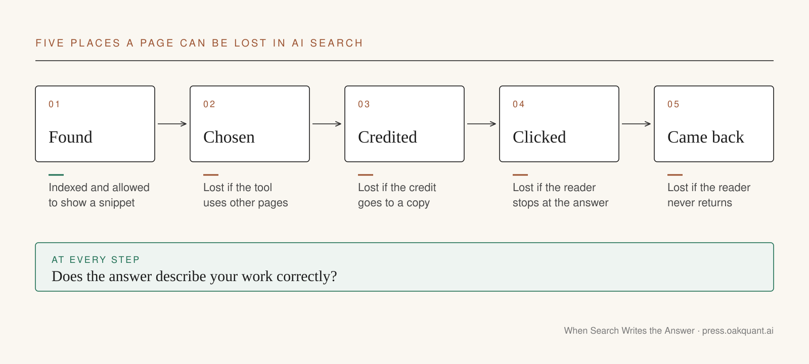

I built a chatbot that answers questions using one of my essay series. When you ask it something, it finds the right passages, writes an answer and shows which essay it used. It works well. That creates a problem for me as a writer. A person who gets a good answer may have no reason to open the essay. The link is there, but they already have what they came for.

Google, OpenAI and Perplexity now do the same thing for the whole web. You ask a question. The search tool reads a handful of pages, writes the answer and puts small links beside it. Your article can supply the answer and still get no visit.

The people who sell help with this call it generative engine optimization, or GEO. The name comes from a [2023 paper by Pranjal Aggarwal and five colleagues](https://arxiv.org/abs/2311.09735) at Princeton, Georgia Tech, the Allen Institute for AI and the Indian Institute of Technology in Delhi. GEO means making your pages more likely to be found, used and credited when an AI tool writes an answer. It matters because more questions now end on that answer instead of on your page.

This essay covers two things. How to become one of the sources an AI tool uses, and what that is worth to a publisher. It ends with a checklist of tests you can run on your own site.

## Search used to send people to you

Traditional search gave you a list of links. You chose a page, opened it and judged it yourself. The publisher got the visit even if the page disappointed you.

AI search does more of the reading for you. It pulls passages from several pages, writes one answer and puts links next to it. Google's developer documents call this lookup step grounding the answer. The technical name is retrieval-augmented generation, usually shortened to RAG. It means the tool looks things up before it answers, like a colleague who checks the file before replying instead of answering from memory.

That lookup step means a page can now fail in five places. It can be found and not chosen. It can be chosen while the credit goes to a site that copied it. It can be credited and get no click. It can get the click from a reader who never returns. And it can be cited in an answer that describes its content incorrectly.

GEO covers the first three of those failures. A publisher has to care about all five.

## Getting into AI answers mostly follows the old rules

GEO sounds like a new trade with new tools. Google says most of it is not new. Its [Search Central page on AI features](https://developers.google.com/search/docs/appearance/ai-features) says the usual search engine optimization, or SEO, still applies to AI Overviews and AI Mode. SEO is the craft of getting pages found and ranked, and it is what most web teams already do. The same page says there are no extra technical requirements for showing up in AI answers.

A page has to be indexed, which means Google has stored a copy, and it has to be allowed to show a snippet. That makes a page eligible. It does not mean it will be used.

So start with the boring checks. Can Google reach your important pages? Are they linked from other pages on your site? Is the key text written as text, and not only shown in an image? Fix those before you pay anyone for a strategy.

What changes is what you watch. Old search asked if a page was found and if people visited. AI search adds three more checks: was the page chosen, who got the credit, and did the answer get it right.

## Search access and training are separate permissions

Two things get mixed up here. One is a search tool reading your page to answer a question today, and the other is a company copying your page so it can train the next version of its model on it.

A crawler is the program a company sends out to read websites, and each one has a name that you can allow or block in a small file on your site called robots.txt. OpenAI runs one crawler, `OAI-SearchBot`, for its search results and another, `GPTBot`, for gathering training data. You can say yes to the first and no to the second. Google now has a separate control for its own AI features. In June 2026 it [announced a Search Console setting](https://blog.google/products-and-platforms/products/search/new-opportunities-control-and-insights-for-website-owners/) that keeps a site out of AI Overviews, AI Mode and AI Overviews in Discover while leaving it in ordinary search results. Google started with a group of site owners in the UK. Check whether your account has it. A site that opts out gets no traffic from those features, and the setting does nothing about ChatGPT or Perplexity.

So a single rule like "block AI" or "allow AI" is too broad. Decide crawler by crawler, and read what each platform actually offers before you decide.

## Give the tool something it cannot get elsewhere

The hardest question is editorial. What does this page have that the other twenty pages on the same topic lack?

Google's advice for AI search asks for unique content that is not a commodity: firsthand experience, real expertise and a point of view nobody else has. The Aggarwal paper points the same way. The team tested changes against 10,000 questions and found that adding quotations, statistics and citations raised how often a page showed up in AI answers by as much as 40 percent. On Perplexity, a live AI search engine, the gain was as much as 37 percent. That is a lab result, and the gains varied from one subject area to another. It suggests that evidence helps a page show up. It does not tell you what today's AI search tools will pick.

Two made-up articles about AI agents show the gap. The first lists the usual benefits. The second follows one claims process at an insurer, counts the decisions the agent makes alone, marks where a person still has to sign off and works out the cost of each finished claim.

If the first article disappeared, readers could find the same content elsewhere. If the second disappeared, the information would be gone. That test works on your own drafts. Ask what a reader would lose if this page did not exist, and if the honest answer is nothing, better formatting will not fix it.

## Make the point easy to find

Good work can still be hard to read. The main finding sits in paragraph nine. The headings say Overview and Key Considerations. The writer knows the assumption behind the numbers and never writes it down.

Edit it. Google asks for clear structure and useful headings. In January 2026, on Google's Search Off the Record podcast, Danny Sullivan went further and [asked publishers to stop cutting their articles into bite-sized chunks](https://searchengineland.com/google-doesnt-want-you-to-create-bite-sized-chunks-of-your-content-467269) to please AI tools. He said he had checked with Google's engineers first, and they told him the same thing.

A plain order helps for anything with a finding in it. Say what you found. Say how you found it. Show the evidence. Say where it stops working.

Each section should answer the question its heading raises, in the first paragraph. Each claim should also make sense on its own, because an AI tool may quote one paragraph without the rest. If a claim needs a warning, put the warning next to the claim, because the tool may quote the claim alone.

## Check the technical basics

Some checks are technical and dull, and they are worth doing once a year. Important pages are linked from the rest of the site. Your robots.txt file is not blocking a crawler you meant to allow. Pages you want found are not tagged `noindex`, the label that tells search engines to leave a page out.

Check titles, authors and dates. Google's Article structured data is a small block of labels inside the page that tells search engines the headline, the author and the date. It describes the page. It does not buy a place in AI answers, and Google says no special markup is needed for its AI features. If someone sells you a special tag for AI search, ask them to show you where Google asks for it. Google does not.

## Count what reaches the business

A site can show up in more AI answers and have no idea if that helped. So measure it in steps.

Does the site appear when people ask the questions it covers? When it appears, is the cited page really yours? Does the answer describe your work correctly? Do people click through? And do the ones who click subscribe, come back, get in touch or buy something?

Each question measures something different. The last one comes closest to telling you whether being cited is helping the publication.

The third step is the one most teams skip, and it is the one I would watch first. A wrong answer that cites you can hurt your reputation.

Some of this is now easier to see. Since June 2026, [Google Search Console has a report](https://developers.google.com/search/blog/2026/06/gen-ai-performance-reports) that shows how often your pages appear in AI Overviews and AI Mode. OpenAI says ChatGPT adds a tag, `utm_source=chatgpt.com`, to the links it sends, so those visits can be counted in your analytics. The rest you have to test by hand. The checklist at the end of this essay sets out a repeatable way to do that.

Be careful with what you conclude. If citations go up after an edit, the edit may have helped. A change to the AI tool could also explain it.

## Sort the advice before you follow it

Most GEO advice falls into four piles. Some of it is a written platform rule. Some is a sound publishing habit. Some is a lab finding. And some is a pitch from someone with a product to sell.

"Make important pages crawlable" is a written rule. "Publish original evidence" is a habit that Google's guidance backs. "Add statistics" has one study behind it. "This exact paragraph pattern will get you cited" needs proof, and I have not seen any.

The same goes for the claim that every article needs a block of questions and answers at the bottom. An FAQ helps when the questions are real ones. It is not a requirement, and Sullivan was clear that chopping pages up for machines is the opposite of what Google wants.

Test things anyway. Write down the guess, the change and the result. Do not claim more than the result shows.

## What these measurements cannot tell you

I cannot tell you how much traffic AI answers send compared with old search. Google says people who click through from AI Overviews tend to stay longer on the site they land on. That claim comes from Google's own data, and I have not seen independent data that confirms or contradicts it. The new Search Console report counts appearances in AI answers, which helps, but appearing and being read are different things. Figures for the whole web cannot tell you whether AI search is helping your publication. Your own traffic, citation and sales data can.

## Give people a reason to know your name

Go back to my chatbot. Each answer helps the reader. Sometimes it replaces a visit to the essay. I still think it was worth building.

Every publisher now faces the same trade, except the tool belongs to Google or OpenAI instead of to them. Getting cited in AI answers is one goal. Getting readers to come to you directly is a different goal. GEO can help with the first. The second depends on the work itself: reporting nobody else did, judgment people have learned to trust, and methods they can check for themselves.

This week, pick one article you are proud of. Ask an AI search tool the question it answers, read what comes back with your name on it, and check whether it describes your article correctly.

## A GEO checklist for your own site

These are the tests I run. When a platform changes its rules, or one of my tests shows something new, I change this list and the date here. The list was last updated on November 7, 2026.

1. Build a repeatable test. Write down 20 questions your readers really ask. Ask each one in the main AI search tools, and record the answer and the pages it cites. Your coverage score is how many of the 20 questions have a strong page on your site behind them. Then improve five articles and log every change. Keep the first results, so the check a month later shows what changed. Count only citations inside AI answers, not ordinary search links, and mark any tool you could not reach as untested.

2. Record the conditions with every answer. AI answers change from day to day, and they can differ for signed-in and signed-out users. Note the tool, the date, the mode and whether you were signed in, so a later difference is not mistaken for progress.

3. Leave some articles alone. Change five articles and leave five similar ones untouched. If citations rise at about the same rate in both groups, that weakens the case that your edits caused the rise. A change to the AI tool, or something else that affects both groups, could explain it. Keep testing before you decide.

4. Check each crawler on its own. OpenAI uses `OAI-SearchBot` for search and `GPTBot` for training. Perplexity uses `PerplexityBot`. Google uses `Googlebot` for Search, and a separate robots.txt token, `Google-Extended`, controls whether your pages are used to train its Gemini models. Google says that token has no effect on Search results. Check your robots.txt file and your hosting firewall, because a firewall can block a crawler that robots.txt allows.

5. Look for snippet settings that block you by accident. A page has to be allowed to show a snippet to appear as a link in Google's AI Overviews. A page tagged `nosnippet`, or with `max-snippet` set to zero, cannot show one, so it cannot appear there.

6. Separate AI visits in your analytics. Set up a report for links tagged `utm_source=chatgpt.com` and for visits that arrive from perplexity.ai, so AI visits are not lumped in with direct traffic. Check the generative AI report in Google Search Console as well.

7. Check what each answer says about you. For every citation, compare the answer with the article. When the answer is wrong, find the sentence that led to the mistake and rewrite it, usually by moving a warning or an assumption next to the claim it qualifies.

8. Read your important claims alone. An AI tool may quote one paragraph and drop the rest of the article. Check that each important claim is still accurate when quoted by itself, and keep the assumptions and warnings it depends on close to it.

9. Write down what would be missing. For each article, write one sentence on what a reader would lose if the article did not exist. If you cannot write that sentence, the article needs new reporting, a test or a calculation before it needs better formatting.

10. Put key facts in text. Do not leave important figures only inside a chart image or a screenshot of a table. Put the main numbers in the text next to the image, so a reader or a search tool does not have to interpret the picture to get them.

11. Keep dates and authors accurate. The date, author and title readers see should match the structured data in the page. Change the updated date only when the content changed.

12. Sort advice before acting on it. Give every tip one of four labels: a written platform rule, a publishing habit, a lab finding or a sales claim. Only the first kind is a requirement.
